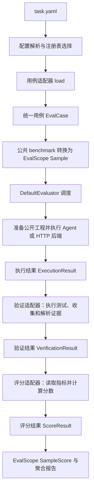

# HarmonyEval 适配器设计与实现说明

更新日期：2026-11-04。本文说明当前 `harmonyeval/` 源码的实现，重点回答三个问题：不同格式的用例如何交给 EvalScope、验证流程如何接入、验证结果如何变成分数。示例遵循当前接口；示例中的外部验收程序和服务需要场景开发者提供。

本文适合新增场景或接手框架的开发者、Agent 阅读。整体迁移步骤见[框架设计与重构指南](harmony-eval-framework-design.md)，完整 YAML 字段和各场景配置见[YAML 配置说明与场景示例](harmony-eval-task-examples.md)。

## 阅读导航

- [1. 整体评测流程](#1-一次评测经过哪些步骤)
- [2. 源码分工](#2-源码怎么分工)
- [3. 四种数据契约](#3-四种数据契约)
- [4. 原始用例 → EvalCase → EvalScope Sample](#4-不同格式的用例怎样转换成-evalscope-输入)
- [5. EvalScope 回调与单用例执行顺序](#5-evalscope-怎样调用执行验证与评分)
- [6. 验证适配器接口、调度和内置实现](#6-验证适配器怎样实现)
- [7. 评分接口、公式和 L2/L3 示例](#7-评分适配器怎样实现)
- [8. SampleScore 与结果聚合](#8-分数怎样交回-evalscope-与报告)
- [9. 三个适配器的完整扩展示例](#9-怎样新增三个适配器一个完整扩展示例)
- [10. 结果目录、复评与接入检查](#10-怎样复用结果与定位问题)

## 1. 一次评测经过哪些步骤

一份 `task.yaml` 选择用例、被测对象、验证流程和评分规则。框架把它们连接到同一条 EvalScope 流水线：



对照实验会在外层展开多个实验组，每组复用这条流水线。各组的用例、工作工程和结果分开保存。

三种业务适配器的边界如下：

| 适配器 | YAML 入口 | 主要输入 | 主要输出 | 负责的事情 |
|---|---|---|---|---|
| 用例适配器 | `dataset.type` | 原始 JSON、JSONL、工程目录、case.yaml 等 | `list[EvalCase]` | 读懂数据布局，整理公开输入与评估资料，准备工程 |
| 验证适配器 | 活动目标块下 `verification[].type` | 完整用例、Agent 结果、前置验证结果 | `VerificationResult` | 运行 UITest、云测试、评价 Skill、模型裁判或验收程序，产出可复核指标 |
| 评分适配器 | 活动目标块下 `scoring[].type` | 各验证结果组成的字典 | `ScoreResult` | 确定性计算分数、扣分和明细 |

另外两层负责“测谁、怎样执行”：`target.type` 选择被测对象适配器，`execution.engine` 选择 OpenCode 或 HTTP 执行引擎。新增数据格式、验证方法、评分公式通常无需改这两层。

`scenario` 是场景标签。选择具体实现靠注册名和 `type`，没有按一多、迁移、问答分别复制主调度器。

## 2. 源码怎么分工

下文源码路径均相对于仓库根目录。

| 源码 | 当前责任 |
|---|---|
| `harmonyeval/api/contracts.py` | 四种数据契约 |
| `harmonyeval/api/interfaces.py` | 扩展接口和公共 `Workflow` 基类 |
| `harmonyeval/api/registry.py` | 注册、entry point 发现和参数校验 |
| `harmonyeval/config/loader.py` | 解析 task YAML、规范化已知路径、校验引用和依赖 |
| `harmonyeval/benchmarks/{multidev,migration,text_qa}.py` | 不同用例格式的读取 |
| `harmonyeval/benchmarks/base.py` | 工程准备、公开输入与评估证据指纹、用例筛选 |
| `harmonyeval/benchmarks/evalscope.py` | 统一对接 EvalScope 的 `HarmonyBenchmarkAdapter` |
| `harmonyeval/evaluator/runner.py` | 配置并启动 EvalScope `DefaultEvaluator` |
| `harmonyeval/evaluator/sample.py` | 单用例工程准备、输入快照、Agent 执行和补丁归档 |
| `harmonyeval/agent/service.py` | 按 target/engine 执行被测对象 |
| `harmonyeval/verification/pipeline.py` | 验证依赖调度、资源互斥、异常处理和临时目录清理 |
| `harmonyeval/verification/context.py` | 工程副本、命令执行、用例级验证配置合并 |
| `harmonyeval/verification/workflows/` | 内置验证适配器 |
| `harmonyeval/metrics/{scoring,sources,aggregation}.py` | 评分调用、指标取值和有效分数聚合 |
| `harmonyeval/metrics/rules/` | 内置评分规则 |
| `harmonyeval/evaluator/replay.py` | 复评 `verify` 与重算 `rescore` |

当前所有场景共用注册名为 **`harmony_eval`** 的 EvalScope benchmark。`swe-bench-hm-multi-dev`、`library-migration` 等是框架内部的数据集注册名，不是每个场景各注册一套 EvalScope benchmark。

当前安装依赖限定为 `evalscope>=1.14.1,<1.15`，兼容检查接受 1.14.x。下文按本仓库桥接源码说明接口；升级 EvalScope 时要重新核对回调、Sample、TaskState 和评分对象。

## 3. 四种数据契约

这些契约是业务适配器之间的交接格式。EvalScope 的 `Sample`、`TaskState` 和 `SampleScore` 则由公共 benchmark 在边界处转换。

### 3.1 EvalCase：把不同输入整理成同一种用例

当前定义可以简写为：

```python
@dataclass
class EvalCase:
    case_id: str
    question: str
    root: str
    project: str = ""
    expected: dict = field(default_factory=dict)
    metadata: dict = field(default_factory=dict)

    def public(self):
        return {"case_id": self.case_id, "question": self.question}
```

| 字段 | 含义 | 例子 |
|---|---|---|
| `case_id` | 用例稳定标识，用于选择、目录、结果配对 | `library_a`、`qa_001` |
| `question` | 公开问题或任务提示词的实际文本 | PROMPT.md 内容 |
| `root` | 原用例资料根目录，评估侧相对路径从这里解析 | 某个用例目录；文本用例为数据文件所在目录 |
| `project` | 原始公开工程路径；纯文本用例为空 | 待转换库的 source/ |
| `expected` | 标准答案、验收测试路径、参考补丁等评估资料 | `reference_answers`、`tests` |
| `metadata` | 适配器或验证器需要的补充信息 | 设备套件、目标模板、用例级 verification 配置 |

`public()` 只返回 `case_id` 和 `question`。工程通过工作目录提供给 Agent，标准答案与评估资料由验证阶段读取。

### 3.2 ExecutionResult：记录被测对象实际做了什么

主要字段是 `status`、`answer`、`project`、`workspace`、`error`、`failure_category`、`elapsed_seconds`、`usage`、`artifacts`、`capabilities`、`tool_calls`。

- `project` 指最终目标工程根；纯文本任务为空。
- `workspace` 是会话工作目录；Web 组合工程中，实际目标工程可能是它的子目录。
- `answer` 是最终文本，不能单独证明工程或功能正确。
- `capabilities`、`tool_calls` 可用于核对 Agent、Plugin、Skill、MCP 的实际装载和调用。
- 执行状态由具体执行引擎产生，可见 `completed`、`failed`、`error`、`timed_out`、`interrupted` 等字符串。它们没有由 dataclass 强制成枚举。

### 3.3 VerificationResult：记录证据与业务指标

```python
VerificationResult(
    verifier_id="ui",
    status="completed",
    metrics={"tests_run": 10, "passes": 8, "pass_rate": 0.8},
    dimensions=[],
    findings=[],
    evidence=[".../verification/ui/result.json"],
    error="",
    version="1",
)
```

`completed` 表示验证获得了可解释的结果，允许其中存在失败断言。上例表示实际执行了 10 项测试、8 项通过。

`dimensions` 可保存白盒各维度的 `name/score/max_score`；`findings` 保存问题、理由或限制；`evidence` 保存证据路径或 JSON 可序列化的证据内容。

### 3.4 ScoreResult：记录评分规则的计算结果

```python
ScoreResult(
    dimension="functional",
    status="scored",
    score=80,
    max_score=100,
    breakdown=[{"source": "ui.metrics.pass_rate", "raw": 0.8}],
    error="",
    version="1",
)
```

缺失证据时使用 `status="unavailable"` 和 `score=None`。业务验证支持的零分使用 `status="scored"` 和 `score=0`，两者会影响不同的统计项。

## 4. 不同格式的用例怎样转换成 EvalScope 输入

转换分两层完成：

```text
原始用例文件/目录
  └─ 对应 DatasetAdapter.load(config)
       └─ list[EvalCase]
            └─ HarmonyBenchmarkAdapter.load_dataset()
                 └─ Sample → MemoryDataset → DatasetDict["default"]
```

### 4.1 第一层：各适配器生成 EvalCase

| `dataset.type` | 当前类 | 原始输入 | 归一化方式 |
|---|---|---|---|
| `swe-bench-hm-multi-dev` | `MultiDevDataset` | 子目录中的 PROMPT.md、base/ 或 task/、metadata.json | 提示词变为 question；工程路径变为 project；补丁路径进 expected；原 metadata 保存在 metadata.native |
| `library-migration` | `MigrationDataset` | case.yaml 布局或原始仓库布局 | instruction 文件/共同任务要求变为 question；原库为 project；验收资料进 expected |
| `android-migration` | 同一个 `MigrationDataset` | 与库迁移相同的布局，工程是 Android 应用 | 与库迁移共用数据处理，实现差异由任务、Agent 和验证配置表达 |
| `text-qa` | `TextDataset` | JSON 数组、含 cases 数组的 JSON 对象、JSONL 文件或包含这些文件的目录 | 问题变为 question；标准答案归一到 expected.reference_answers；project 为空 |

#### 一多工程示例

```text
cases/
└── CaseA/
    ├── PROMPT.md
    ├── base/
    ├── metadata.json
    ├── test_patch.patch
    └── golden_patch.patch
```

`MultiDevDataset.load()` 遍历 dataset.dir 的子目录，优先取 base/，其次 task/。缺少工程或 PROMPT.md 的子目录会被跳过；metadata.json 存在时读取，否则用空字典。

```json
{
  "case_id": "CaseA",
  "test_patch": "test_patch.patch",
  "golden_patch": "golden_patch.patch"
}
```

补丁是否进入 `expected` 取决于 metadata 中是否声明相应字段，并非扫描到同名文件就自动推断。设备套件等内容保存在 `metadata.native`，后续 UITest 再使用。Web 用例会把整个组合目录作为公开工程来源，并通过 `project_path()` 定位其中的 native 工程。

#### 迁移工程示例

```text
cases/
└── library_a/
    ├── case.yaml
    ├── PROMPT.md
    ├── source/
    └── grading/
        └── verification.yaml
```

```yaml
# library_a/case.yaml
id: library_a
input:
  project: source
  instruction: PROMPT.md
expected:
  tests: grading
verification:
  functional:
    build_command: [node, --check, index.js]
    test_command: [node, evaluation-tests/test.js]
    exit_code_is_test_result: true
```

此例在 `metadata.verification.functional` 中保存用例级参数；这里的 `functional` 对应任务中的 verification.id。也可以在 grading/verification.yaml 声明参数。`test.js` 及真实验收逻辑由用例提供。

`MigrationDataset` 会向原提示词追加工程目录约定，要求最终工程落在本用例 `base/`。因此它的 `question` 是文件内容加目录说明。

若声明 `input.target_template`，原工程复制到会话目录相邻的 `input/`，目标模板复制到 `base/`。没有模板则直接从原工程副本开始。

`layout: repositories` 不读取逐用例 case.yaml，改用共同的 `dataset.instruction`、`dataset.expected`、`dataset.verification`。目录自身包含 `pubspec.yaml`、`package.json`、`build.gradle`、`build.gradle.kts`、`settings.gradle` 任一标记时，把它当作一个仓库；否则取非隐藏子目录作为各个仓库。

`expected.output_kind`、`expected.output_project` 当前会被拒绝；产物要求写在任务提示词中，工程根使用统一约定。

#### 文本 JSON 示例

```json
[
  {
    "id": "qa_001",
    "question": "UIAbility 的作用是什么？",
    "reference_answer": "UIAbility 是包含用户界面的应用组件。",
    "criteria": {"required_points": ["包含用户界面"]},
    "metadata": {"category": "ability"}
  }
]
```

归一化后相当于：

```python
case = EvalCase(
    case_id="qa_001",
    question="UIAbility 的作用是什么？",
    root="/path/to/data",
    expected={
        "reference_answers": ["UIAbility 是包含用户界面的应用组件。"],
        "criteria": {"required_points": ["包含用户界面"]},
    },
    metadata={"category": "ability", "input_file": "/path/to/data/cases.json", "item_index": 1},
)
```

JSONL 使用每个非空行一条对象，来源位置记录为 `line`。单数 `reference_answer` 会转成列表；也可直接使用 `reference_answers`。同时提供时，内容必须一致。

`criteria` 的具体含义取决于验证器；例如 ExactMatch 只读取 reference_answers，不会因为 JSON 中出现 required_points 就自动检查这些点。

#### 通用筛选与标识

这些内置适配器最后调用 `select(cases, config)`：检查重复 case_id，应用 case_ids、limit，并拒绝空集合。case_ids 筛选保留原数据集的顺序，limit 再截取前若干项。

case_id 通过 `safe_id()` 校验，可含字母、数字、下划线、点、连字符及正则 `\w` 支持的 Unicode 字符，长度为 1～160；不能用路径分隔符、空格或 `.`、`..` 作为 ID。

### 4.2 第二层：公共 benchmark 生成 Sample

实际转换位于 `HarmonyBenchmarkAdapter.load_dataset()`，核心对应关系如下：

| EvalScope 字段 | 当前赋值 | 原因 |
|---|---|---|
| `Sample.id` | `len(samples)`，从 0 开始 | 给每个“用例 × 轮次”分配样本 ID |
| `Sample.input` | `case.question` | EvalScope 样本的公开任务文本 |
| `Sample.target` | `case.expected.get("reference_answers", [])` | 文本评价的参考答案；工程任务可为空列表 |
| `metadata.case_index` | case 在 self.cases 中的位置 | 找回包含工程、元数据、评估资料的完整用例 |
| `metadata.case_id` | 原 case_id | 报告关联与跨实验组配对 |
| `metadata.round` | 从 1 开始的轮次 | 区分同一用例的多轮执行 |

以下摘录保留了当前转换逻辑；运行时 `self.cases` 已由数据集适配器加载：

```python
from evalscope.api.dataset import DatasetDict, MemoryDataset, Sample

# HarmonyBenchmarkAdapter.load_dataset() 的核心逻辑
def load_dataset(self):
    samples = []
    for round_index in range(1, self.task["active"]["rounds"] + 1):
        for index, case in enumerate(self.cases):
            samples.append(Sample(
                id=len(samples),
                input=case.question,
                target=case.expected.get("reference_answers", []),
                metadata={"case_index": index, "case_id": case.case_id, "round": round_index},
            ))
    self.test_dataset = DatasetDict({
        "default": MemoryDataset(samples=samples, name=self.name),
    })
    return self.test_dataset
```

例如两条用例 A、B，各执行两轮：

| Sample.id | case_index | case_id | round |
|---:|---:|---|---:|
| 0 | 0 | A | 1 |
| 1 | 1 | B | 1 |
| 2 | 0 | A | 2 |
| 3 | 1 | B | 2 |

这是样本展开顺序。实际任务并发由 execution.concurrency 控制，不能据此推断完成顺序。框架自己展开 rounds，EvalScope TaskConfig.repeats 固定为 1，避免再次倍增轮次。

这里有三个容易混淆的地方：

1. YAML 的 `target` 是被测对象；`Sample.target` 是评估参考答案，含义不同。
2. 工程、补丁、设备套件不需要转换成一段大文本塞进 Sample。完整信息仍在 `self.cases`，由 case_index 找回。
3. EvalScope 内部可以持有参考答案；当前公共 benchmark 的执行路径只把 `case.public()` 和准备好的工作目录交给被测执行引擎，不把 Sample.target 拼入 Agent 请求。

因此新增一种输入格式，通常只需实现 `load() -> list[EvalCase]` 及必要的工程准备方法，继续复用公共 Sample 转换。

### 4.3 工程准备与输入边界

`DatasetAdapter.prepare(case, workspace)` 负责复制公开工程。当前 workspace 是该次用例执行的 `base/`：

- 默认过滤 .git、node_modules、oh_modules、build 等目录。
- 对 expected.tests、api_mapping、test_patch、golden_patch 指向的已知路径做复制过滤。
- 支持目标模板和相邻 input/。
- `MultiDevDataset.archive_evidence()` 在 Agent 执行步骤结束后，把 metadata 和声明的 test/golden patch 归档到用例产物目录。

这是文件准备上的隔离。Agent 的工具是否能越过工作目录访问原用例路径，仍由运行权限或操作系统沙箱决定。

数据集扩展应继承 `DatasetAdapter` 复用以下能力：

| 方法 | 需要考虑什么 |
|---|---|
| `load(config)` | 输入格式、必填项、唯一 ID、公开文本与评估资料拆分 |
| `prepare(case, workspace)` | 公开工程复制、模板、私有文件过滤 |
| `project_path(case, workspace)` | 工程最终根位置；工程用例的执行阶段会调用它 |
| `fingerprint(case)` | 原工程、公开提示词、目标模板的变化 |
| `evidence_fingerprint(case)` | 标准答案、metadata、评估文件的变化 |
| `archive_evidence(case, output)` | 可选的执行后归档；基类默认返回空字典 |

公开 DatasetLoader Protocol 没有列出所有运行期辅助方法。工程类适配器直接继承 DatasetAdapter，可以避免漏掉 project_path。新增私有资料字段时，也要扩展过滤、证据指纹和归档，不能只增加一个 expected 键。

## 5. EvalScope 怎样调用执行、验证与评分

`evaluator/runner.py` 创建 `TaskConfig`，固定使用 datasets=['harmony_eval']，通过 dataset_args.extra_params 传入规范化 task 和 run_root，然后实例化 `DefaultEvaluator`。

| EvalScope 回调 | HarmonyEval 当前工作 |
|---|---|
| `load_dataset()` | EvalCase → Sample → MemoryDataset |
| `run_inference()` | 找回完整用例，执行 execute_sample()，返回 TaskState |
| `calculate_metrics()` | 调用验证 pipeline 和 calculate_scores，返回 SampleScore |
| `aggregate_scores()` | 按 scoring.dimension 聚合有效值 |
| `generate_report()` | 转成 EvalScope Report/Metric 等对象 |

单用例的执行顺序是：

```text
run_inference(model, sample, ...)
  ├─ case = self.cases[sample.metadata["case_index"]]
  ├─ 确定 variants/<variant>/round-XX/cases/<case_id>/
  └─ execute_sample(task, case, folder)
       ├─ adapter.prepare(case, folder/base)
       ├─ capture_verification_inputs()：冻结转换前证据
       ├─ 工程任务初始化 Git 基线
       ├─ execute_agent() → target.prepare() → engine.execute(case.public(), ...)
       ├─ 填写 ExecutionResult.project / workspace
       ├─ 工程任务保存 change.patch
       └─ archive_evidence()，并记录 artifacts.case_output
```

然后将 `execution.answer` 包装成 EvalScope `ModelOutput`，放入 TaskState.output；完整 execution 字典和 case_output 放入 TaskState.metadata。Sample 的 case_index、case_id、round 元数据用于后续关联。

公共桥接返回的 `TaskState.completed=True` 表示这次推理步骤已经返回，实际 Agent 是否成功仍读取 `ExecutionResult.status`。

## 6. 验证适配器怎样实现

### 6.1 验证接口

当前验证器通常继承 `Workflow`，实现：

```python
async def verify(self, case, execution, dependencies, context, config):
    ...
    return VerificationResult(
        verifier_id=config["id"],
        status="completed",
        metrics={"pass_rate": 0.8},
        evidence=["实际证据的路径"],
        version=self.version,
    )
```

| 参数 | 实际内容 |
|---|---|
| `case` | 完整 EvalCase，允许访问标准答案、验收测试和设备元数据 |
| `execution` | 本次被测对象的 ExecutionResult |
| `dependencies` | depends_on 中列出的流程 ID 到结果字典的映射 |
| `context.task` | 规范化任务；代码中使用 `context["task"]` 访问 |
| `context.output` | 本流程持久证据目录；代码中使用 `context["output"]` |
| `context.env` | 合并工具链后的环境变量 |
| `context.cancel_event` | 取消信号 |
| `context.temporary_projects` | 框架最后统一清理的临时目录清单 |
| `config` | 当前 verification 条目的配置，包含 id、type 和类型专用字段 |

模型调用、设备执行、远程服务请求、报告解析都可放在验证器。最终只能返回 JSON 可序列化的指标与证据。

### 6.2 调度和依赖

配置解析时，`flow_order()` 检查 ID 重复、未知依赖和依赖环。未填写 id 时默认使用 type；同类型多个实例应分别命名。

运行时，`pipeline()` 反复选择所有依赖已产出结果的流程，以 asyncio.gather 并发执行，再将结果写成：

```json
{
  "ui": {
    "verifier_id": "ui",
    "status": "completed",
    "metrics": {"tests_run": 10, "passes": 8, "pass_rate": 0.8},
    "dimensions": [],
    "findings": [],
    "evidence": [".../verification/ui/result.json"],
    "error": "",
    "version": "1"
  }
}
```

这个结果字典保存在 task-report.json 的每条 record.verification 中。pipeline 不会替所有验证器自动生成独立的 verification-result.json；详细报告文件由各验证器自行落盘。

调度规则：

| 条件 | 默认行为 |
|---|---|
| 收到取消信号 | 流程 skipped |
| 任一 depends_on 流程状态不是 completed | 当前流程 skipped |
| Agent 未 completed，requires_execution 未设为 false | 当前流程 unavailable |
| 验证器抛出被 pipeline 捕获的运行异常 | 当前流程 unavailable，并记录错误 |
| 前置流程 completed，但 metrics 中有 false | 仍可继续；验证器需要自行检查前置业务指标 |

比如“已执行但有断言失败”的 UI 流程可返回 completed + pass_rate=0.8，下游仍能分析失败。依赖状态和业务是否通过是两个判断。

`Workflow.requirements(config)` 默认读取 resources。pipeline 按资源名排序加锁，协调同一进程内的并发验证。UITest 根据 devices 构造 device:... 资源名，CloudTest 使用 agc-cloud-submit。这套锁不代替跨进程的设备租约。

### 6.3 工程副本、命令和用例级参数

公共辅助函数来自 `verification/context.py`：

| 函数 | 行为 |
|---|---|
| `isolated_project(execution, context)` | 在系统临时目录复制目标工程，登记结束清理 |
| `command_run(command, project, context, label, timeout)` | 参数数组执行；持久保存 stdout、stderr 原始字节日志及退出码，支持超时和取消 |
| `workflow_settings(case, config)` | 合并用例级验证设置和任务设置 |

command_run 只替换 `${project}` 与 `${output}`，不隐式启动 shell；Python、Node、SDK 等命令需在执行环境中可用。stdout/stderr 是原始工具字节，读取时按实际协议解码。

workflow_settings 的取值顺序为：

1. 优先读取 `case.metadata.verification[config.id]`；该键不存在时尝试 `[config.type]`。
2. 上述结果为空且 expected.tests 指向 YAML 或含 verification.yaml 的目录时，读取该文件。
3. 使用任务 verification 条目的同名字段覆盖用例级值；这是浅层合并。

不是所有验证器都会自动调用 workflow_settings。当前 LibraryTests、LibraryAPICount 等主动使用它；自定义流程需要自行调用。

### 6.4 执行前快照

需要对比转换前后 API 时，验证器还可实现：

```python
async def capture_input(self, case, config):
    # 返回可 JSON 序列化的原始工程统计，框架负责持久保存。
    return {"total": 12, "counts": {"types": 2, "callables": 8, "properties": 2}}
```

execute_sample 在 Agent 执行前调用它，生成：

```text
verification/<id>/input-evidence.json
```

成功内容为 `{"status":"completed","data":...}`，异常则保存 unavailable 和 error。verify 应检查此快照的状态。LibraryAPICount 正是先冻结原 API 清单，之后统计目标工程。

verify 复评命令不会重新执行输入捕获。历史运行没有所需快照时，应重新 run，不能用改后的工程补造转换前数据。

### 6.5 当前验证类型和能力范围

| verification.type | 主要工作 | 常用结果或限制 |
|---|---|---|
| `Command` | 在临时工程运行指定命令 | metrics.passed；正常返回的非零退出码表示 completed + passed=false，需场景保证该协议适用 |
| `LibraryTests` | 合并配置、复制验收资料、执行构建和测试，按需解析 JUnit | build_passed、all_tests_passed、pass_rate；无 JUnit 时仅显式 exit_code_is_test_result=true 才用退出码生成通过率 |
| `LibraryAPICount` | 执行前后以语法树统计公开 API 分类数量 | count_match、total_match、count_consistency、counts 等；不证明逐项对应或行为兼容 |
| `LibraryAPICompatibility` | 根据 api_mapping 检查目标符号存在性 | 加权 coverage；是文本符号覆盖，不证明语义等价 |
| `UITest` | 准备验证工程、补丁与设备配置，运行 ohosTest 并解析结果 | build_passed、tests_run、passes、pass_rate、all_tests_passed；无有效断言或设备结果不完整时不可用 |
| `CloudTest` | 构建/准备包、提交云任务、轮询并解析设备和规则报告 | passed、pass_rate、device_count 等；云任务结束不等于通过 |
| `AGCDetection` | 指定命令或显式 HTTP 检测协议 | 命令模式复用 Command；HTTP 模式要求返回结果含布尔 passed |
| `ExactMatch` | 最终回答与任一标准字符串去首尾空白后相等 | passed 和 0/100 的 score |
| `LLM_judge` | 按标准答案、criteria、参考文档或 rubric 调用模型裁判 | score、total_score、dimensions、findings；解析失败不生成有效得分 |
| `whiteboxeval` | 模型读取任务、工程源码、可用的 change.patch 与白盒判据 | 总分与维度分；当前不是自动启动整个 ArkAnalyzer 集成工具链 |
| `ToolUsage` | 从实际能力配置及调用记录观察目标 MCP | configured、enabled、attempted、succeeded；未调用不能推断知识已被使用 |
| `SkillVerifier` | 在独立副本中执行评价 Skill | 必须最终返回含 metrics 的 JSON，可带 dimensions/findings；不自动解析任意 Markdown 报告 |
| `Workflow` | 用 steps/workflow_path 组合已有验证器 | 内部再次调用 pipeline，按 metrics 映射导出值，子结果放在 evidence 中 |

UITest 和云测试内部可包含编译、安装、测试和解析。框架目前没有要求场景额外增加通用 build 节点。

`Workflow` 的内部结果不自动展开成顶层流程 ID。需要评分的子指标应通过该组合流程的 metrics 导出，再以 `组合id.metrics.字段` 引用。

### 6.6 当前状态语义必须按源码理解

实际验证器会返回 completed、failed、unavailable、skipped 等字符串。推荐将实际执行的断言失败表达成 completed + 失败指标；LibraryTests 的构建失败、部分 UITest 情况仍会返回 failed。

当前 `source_value()` **只明确拒绝 unavailable、skipped、error，以及值为 None 的来源**，不会统一拒绝 failed。因此：

- 构建失败时，读取 pass_rate=None 会得到 unavailable；读取 build_passed=false 则可得到有效业务低分。
- 不能把“非 completed 一律不评分”描述成当前代码行为。
- `depends_on` 则确实要求前置状态为 completed，规则与评分取值不同。

新增验证器应明确失败分类和哪些指标仍然有效，不能通过填默认零掩盖工具缺失或报告损坏。

## 7. 评分适配器怎样实现

### 7.1 从 verification 到 scoring 的引用关系

```yaml
verification:
  - id: ui
    type: UITest
    # 此处省略设备和工具链配置，仅说明引用关系。
scoring:
  - dimension: functional
    type: ImmediateValue
    source: ui.metrics.pass_rate
    scale: 100
```

| 字段 | 作用 |
|---|---|
| verification.type | 选择验证类 |
| verification.id | 给该次验证结果命名，成为 results 字典的键 |
| scoring.type | 选择评分类 |
| scoring.dimension | 给最终评分项命名，成为 scores 字典和报告列的键 |
| scoring.source | 指向某个验证结果字段 |

`source_value(results, "ui.metrics.pass_rate")` 先取 results['ui']，检查来源状态，再逐段取 metrics、pass_rate。也能使用列表下标，如 `code.dimensions.0.score`。没有 JSONPath 通配符或表达式求值。

配置加载阶段检查 source/cap_source 的首段是否为已声明的顶层验证 ID；后续字段存在性和值是否合法，到运行期才检查。

### 7.2 评分调用和异常

`calculate_scores(results, rules)` 对每个评分条目调用：

```python
scorers.get(config["type"])().score(results, config)
```

评分接口为同步的 `score(results, config) -> ScoreResult`。函数内部只读取验证结果并计算分数，不执行测试、请求模型或重跑 Agent。

KeyError、ValueError、TypeError、IndexError 会被当前 calculate_scores 转为 unavailable，score 为 None；其他异常不保证被该函数兜底。数值校验可复用 `utils.numbers.number()`，它拒绝布尔值、NaN 和无穷值。

### 7.3 三种内置规则

| scoring.type | 计算方式 | 关键参数 |
|---|---|---|
| `BooleanScoring` | all 中每个 source 的值等于 equals 时得 pass_score，否则得 fail_score | all 非空；默认 pass_score=100、fail_score=0 |
| `ImmediateValue` | score = 指标 × scale，要求结果在 [0,max_score] 内，超界不截断 | source；默认 scale=1、max_score=100 |
| `WeightedSummation` | 按各组件分配分值，再按归一化指标比例扣分 | components 非空，weight 非负且总和为 1，base_score 默认 100 |

WeightedSummation 对普通数值组件：

```text
组件满分 = base_score × weight
归一化质量 = (raw - range.lower) / (range.upper - range.lower)
组件扣分 = 组件满分 × (1 - 归一化质量)
最终得分 = base_score - 所有组件扣分之和
```

range 默认 [0,100]，指标须位于范围内，上界须大于下界。

对于 `reducer: proportional_deduction`：

```text
维度分配 = 组件满分 × 该维度 max_score / 所有维度 max_score 合计
维度扣分 = 维度分配 × (1 - score / max_score)
```

dimensions 必须非空，维度满分须为正且得分合法。cap_source 可根据裁判总分进一步限制该组件得分，量纲应与维度满分合计一致。

当前 validate 接受 mode=deduction 或 sum，但 score() 共用同一套上述计算；不要据字段名假设 sum 另有独立算法或允许不同权重约束。

### 7.4 当前一多 L2/L3 的实例

这是已确认的一多口径，不是所有场景的默认标准：L2 中 UITest 通过率代表 UX，占 50%；白盒各维度按满分比例分配其余 50%；L3 直接取白盒总分。

```yaml
scoring:
  - dimension: L2
    type: WeightedSummation
    mode: deduction
    base_score: 100
    components:
      - name: UX
        source: ui.metrics.pass_rate
        range: [0, 1]
        weight: 0.5
      - name: Whitebox
        source: code.dimensions
        reducer: proportional_deduction
        cap_source: code.metrics.total_score
        weight: 0.5
  - dimension: L3
    type: ImmediateValue
    source: code.metrics.total_score
```

假设 UI 通过率为 0.8，白盒两个维度分别得 30/40、40/60，总分为 65：

- UX 分配 50 分，扣 10 分，得 40 分。
- 白盒维度原本得到 15 + 20 = 35 分；总分上限进一步限制为 50×65/100=32.5 分。
- L2 得 72.5 分；L3 得 65 分。

## 8. 分数怎样交回 EvalScope 与报告

`HarmonyBenchmarkAdapter.calculate_metrics()` 完成三件事：

1. pipeline 生成 verification 字典，calculate_scores 生成 scores 字典。
2. 保存业务 record：case_id、round、完整 case、输入指纹、execution、verification、scores。
3. 只把 status=scored 的维度转换成 EvalScope 数值字典。

例如：

```json
{
  "functional": {"status": "scored", "score": 80, "max_score": 100},
  "whitebox": {"status": "unavailable", "score": null, "max_score": 100}
}
```

交给 EvalScope `Score.value` 的只有 `{"functional":80}`。SampleScore 使用 Sample 的数字 ID，并带 case_id 和 round。

- 至少有一个有效维度时，Score.status 为 SUCCESS。
- 没有任何有效维度时，Score.status 为 EXCLUDED。
- 验证结果和各维度不可用原因仍保存在 Score.metadata 和业务报告中。
- 某一维度缺失不阻止另一维度保留有效分数。

aggregate_sample_scores 按维度计算有效值的平均数，生成 EvalScope AggScore。业务 task-report.json 另外记录 mean、scored、total、coverage，保留计划样本分母，避免只看平均分忽略缺失。

运行命令退出码主要表示执行与评分是否完整：有效的零分仍可退出 0；Agent 失败、计划样本缺失或存在 unavailable 的评分项会使任务退出码为 1。不能把退出 0 当作全部业务测试通过。

## 9. 怎样新增三个适配器：一个完整扩展示例

下面示例新增一种 JSON 工程清单格式、一个读取验收 JSON 的验证器和一个通过率扣分规则。它们复用现有执行引擎与 EvalScope 桥接，不修改主调度。

### 9.1 扩展包布局与注册

```text
example-eval-extension/
├── pyproject.toml
└── example_eval/
    ├── __init__.py
    ├── datasets.py
    ├── verifiers.py
    └── scorers.py
```

```toml
[build-system]
requires = ["setuptools>=61"]
build-backend = "setuptools.build_meta"

[project]
name = "example-eval-extension"
version = "0.1.0"
requires-python = ">=3.10"
dependencies = ["harmonyeval>=0.3.0"]

[project.entry-points."harmonyeval.datasets"]
project-manifest = "example_eval.datasets:ProjectManifestDataset"

[project.entry-points."harmonyeval.verification"]
JsonAcceptance = "example_eval.verifiers:JsonAcceptance"

[project.entry-points."harmonyeval.scoring"]
PassRateDeduction = "example_eval.scorers:PassRateDeduction"

[tool.setuptools.packages.find]
where = ["."]
include = ["example_eval*"]
```

Registry.get() 会先注册内置类，再发现安装环境中的 entry points。当前首选命名空间为 harmonyeval.*，兼容旧 harmony_eval.*。未知名字或重复注册会报错。

外部 entry point 类不再使用内置 registry 装饰器，以免重复注册。内置类采用 @datasets.register 等装饰器，并由 api/builtins.py 导入；普通扩展使用安装包即可，不需要修改中央 BUILTINS 列表。

Registry.validate() 先按可选 schema 做 JSON Schema 校验，再执行可选的 validate(config)。它只检查类型声明的参数，新字段不会自动获得路径解析或语义。

### 9.2 用例适配器

假设新的数据布局是：

```text
cases/
├── manifest.json
└── case_a/
    ├── PROMPT.md
    ├── source/
    └── grading/
        └── acceptance.py
```

```json
{
  "cases": [
    {
      "id": "case_a",
      "dir": "case_a",
      "project": "source",
      "instruction": "PROMPT.md",
      "expected": {"tests": "grading"}
    }
  ]
}
```

`example_eval/datasets.py`：

```python
import json
from pathlib import Path
from harmonyeval.api import EvalCase
from harmonyeval.benchmarks.base import DatasetAdapter, select
from harmonyeval.utils.paths import inside, safe_id


class ProjectManifestDataset(DatasetAdapter):
    version = "1"
    schema = {"type": "object", "required": ["dir"]}

    def load(self, config):
        manifest = Path(config["dir"])
        raw = json.loads(manifest.read_text(encoding="utf-8"))
        cases = []
        for row in raw["cases"]:
            root = inside(manifest.parent, row["dir"], exists=True)
            project = inside(root, row["project"], exists=True)
            if not project.is_dir():
                raise ValueError("project 必须是目录")
            question = inside(root, row["instruction"], exists=True).read_text(encoding="utf-8")
            if not question.strip():
                raise ValueError("任务提示词不能为空")
            expected = dict(row.get("expected", {}))
            if not isinstance(expected.get("tests"), str) or not expected["tests"]:
                raise ValueError("本示例要求 expected.tests 指向验收资料目录")
            if not inside(root, expected["tests"], exists=True).is_dir():
                raise ValueError("验收资料必须是目录")
            cases.append(EvalCase(
                case_id=safe_id(row["id"]), question=question,
                root=str(root), project=str(project), expected=expected,
            ))
        return select(cases, config)
```

该类复用了基类工程复制和指纹方法。新增输入格式后，EvalCase 到 Sample 的转换继续使用第4节同一套代码。

### 9.3 验证器：外部验收报告转换成指标

先定义独立于框架的验收程序协议：脚本接受 --project、--output；最终将以下 JSON 写到 --output 指定位置。实际测试脚本由场景提供。

```json
{"status":"completed","tests_run":5,"passes":4,"failures":1}
```

本示例约定：完整执行且全部通过退出 0；完整执行且存在业务失败退出 1；基础设施失败使用其他退出码或 status=unavailable。tests_run 必须为正，passes+failures 必须等于 tests_run。

`example_eval/verifiers.py`：

```python
import asyncio
import json
import shutil
from pathlib import Path
from harmonyeval.api import Workflow, VerificationResult
from harmonyeval.utils.paths import inside
from harmonyeval.verification.context import command_run, isolated_project


class JsonAcceptance(Workflow):
    version = "1"
    schema = {"type": "object", "required": ["command"],
              "properties": {"command": {"type": "array", "minItems": 1,
                                         "items": {"type": "string"}}}}

    async def verify(self, case, execution, dependencies, context, config):
        project = await isolated_project(execution, context)
        tests = inside(case.root, case.expected["tests"], exists=True)
        await asyncio.to_thread(shutil.copytree, tests, project / "evaluation-tests", dirs_exist_ok=True)
        report = Path(context["output"]) / "acceptance.json"
        report.unlink(missing_ok=True)  # 防止重验误读上次结果
        run = await command_run(config["command"], project, context, "acceptance", config.get("timeout", 600))
        evidence = [run, str(report)]
        if not report.is_file():
            return VerificationResult(config["id"], "unavailable", evidence=evidence,
                                      error="验收报告未生成", version=self.version)
        raw = json.loads(report.read_text(encoding="utf-8"))
        if raw.get("status") != "completed" or run["exit_code"] not in (0, 1):
            return VerificationResult(config["id"], "unavailable", evidence=evidence,
                                      error="验收执行未完成", version=self.version)
        values = [raw[k] for k in ("tests_run", "passes", "failures")]
        if any(type(v) is not int or v < 0 for v in values):
            raise ValueError("测试计数必须是非负整数")
        total, passed, failed = values
        if total == 0 or passed + failed != total:
            raise ValueError("没有有效测试或计数不一致")
        if run["exit_code"] != (0 if failed == 0 else 1):
            raise ValueError("退出码与报告内容不一致")
        return VerificationResult(
            config["id"], "completed",
            metrics={"tests_run": total, "passes": passed,
                     "pass_rate": passed / total, "all_tests_passed": failed == 0},
            evidence=evidence, version=self.version,
        )
```

缺报告、损坏 JSON、计数不合法和基础设施失败都不能产生零分通过率；异常由 pipeline 记录为 unavailable。有 5 项有效测试、4 项通过时，返回 completed 和 pass_rate=0.8，供评分器处理。

这段例子不自动解释任意测试工具的退出码。接入新工具时，需要按其真实报告协议改造验证器。

### 9.4 评分器：只根据已验证指标扣分

`example_eval/scorers.py`：

```python
from harmonyeval.api import ScoreResult
from harmonyeval.metrics.sources import source_value
from harmonyeval.utils.numbers import number


class PassRateDeduction:
    version = "1"
    schema = {"type": "object", "required": ["source"]}

    def score(self, results, config):
        rate = number(source_value(results, config["source"]))
        maximum = number(config.get("base_score", 100))
        if not 0 <= rate <= 1 or maximum <= 0:
            raise ValueError("通过率须在 [0,1]，满分须大于0")
        deduction = maximum * (1 - rate)
        return ScoreResult(
            config["dimension"], "scored", round(maximum - deduction, 6), maximum,
            breakdown=[{"source": config["source"], "pass_rate": rate, "deduction": deduction}],
            version=self.version,
        )
```

这个公式也可用已有 ImmediateValue + scale 表达。这里为了展示评分接口才单独实现；实际开发优先复用内置规则。

### 9.5 任务如何把三个扩展连接起来

以下示例放在 cases/manifest.json 同级的 task.yaml。执行环境需要独立 OpenCode、可用模型以及验收脚本所需工具。

```yaml
schema_version: 2
id: project-manifest-example
scenario: LibraryMigration
dataset:
  type: project-manifest
  dir: ./manifest.json
target:
  type: opencode_agent
opencode_agent:
  execution:
    engine: opencode
    agent_name: build
    timeout: 900
    model:
      name: YOUR_MODEL
      base_url: https://your-provider.example/v1
      api_key: EVAL_MODEL_API_KEY
  verification:
    - id: acceptance
      type: JsonAcceptance
      command:
        - python
        - "${project}/evaluation-tests/acceptance.py"
        - --project
        - "${project}"
        - --output
        - "${output}/acceptance.json"
      timeout: 600
  scoring:
    - dimension: functional
      type: PassRateDeduction
      source: acceptance.metrics.pass_rate
      base_score: 100
  report:
    output_dir: ./reports
    format: html
```

模型参数用真实服务值替换，api_key 填环境变量名。验收命令中的 python 来自已激活的执行环境；跨平台命令使用参数数组，路径占位符由 command_run 替换。

在运行框架的同一环境安装扩展：

```sh
python -m pip install -e /absolute/path/to/example-eval-extension
python -c "from harmonyeval.api import datasets, verifiers, scorers; print(datasets.get('project-manifest')); print(verifiers.get('JsonAcceptance')); print(scorers.get('PassRateDeduction'))"
harmonyeval plan /absolute/path/to/cases/task.yaml
harmonyeval run /absolute/path/to/cases/task.yaml
```

Windows PowerShell 可把安装路径替换为 `C:\work\example-eval-extension`、任务路径替换为 `C:\work\cases\task.yaml`。`plan` 或 `run --check` 检查准备情况，不代表模型和验收程序已经真实执行成功。

## 10. 怎样复用结果与定位问题

### 10.1 单组运行的关键目录

```text
<run_root>/
├── task.resolved.yaml
├── task-report.json
├── index.html
├── evalscope/
│   ├── predictions/...
│   └── reports/...
└── variants/<variant>/round-01/cases/<case_id>/
    ├── base/
    ├── change.patch                 # 工程任务
    ├── metadata.json                # 一多适配器归档，源文件存在时
    ├── test_patch.patch             # 一多 metadata 声明时
    ├── golden_patch.patch           # 一多 metadata 声明时
    ├── generate/...                 # OpenCode 的会话日志与展示
    └── verification/
        └── <id>/
            ├── input-evidence.json  # 实现 capture_input 的流程
            └── ...                 # 本流程自行保存的日志与报告
```

这是结构示意；并非每种场景都生成所有文件，补丁文件名以声明路径为准。对照任务的各组位于批次 experiments/<实验ID>/，上面的 run_root 指其中一个单组目录。

### 10.2 verify 与 rescore 的区别

```sh
harmonyeval verify /absolute/path/to/task.yaml --run /absolute/path/to/single-run
harmonyeval rescore /absolute/path/to/task.yaml --run /absolute/path/to/single-run
```

| 命令 | 会做什么 | 适用变化 |
|---|---|---|
| run | 读取用例、执行 Agent、验证、评分 | 输入、模型、被测能力发生变化，或缺少转换前快照 |
| verify | 复用旧执行结果，重新验证并评分 | 验证器、判据、参考答案、评估资料更新 |
| rescore | 复用旧验证结果，只重算评分 | 权重、分值范围、评分公式变化 |

replay 会核对执行指纹；rescore 还要求验证指纹一致。当前有三种身份：

- execution_fingerprint：公开用例、目标/模型/执行配置、能力文件、数据集/目标/执行器版本等。
- verification_fingerprint：验证配置、验证器版本、rubric/Skill 等文件和评估资料指纹。
- scoring_fingerprint：评分配置和评分器版本。

扩展源码、任意外部命令脚本不保证全部自动进入内容指纹。改变行为或协议时更新类 version，再选择相应阶段重跑。verify/rescore 更新业务报告，并按需要刷新实验比较；不能据此认为 EvalScope 原始 predictions/reports 全部重新生成。

### 10.3 接入前的自验证

| 检查 | 应验证的行为 |
|---|---|
| 用例转换 | 不同原始格式形成正确 EvalCase；参考资料不进入公开请求；重复 ID、空集和越界路径被拒绝 |
| Sample 桥接 | 样本数为用例数×轮次，数字 ID 唯一，case_index 能找回原用例，target 只作评估参考 |
| 验证成功与业务失败 | 真正执行产生有效指标；断言失败能形成有证据的低分 |
| 验证不可用 | 缺工具、缺报告、坏 JSON、零有效断言不能变成有效零分或满分 |
| 评分 | 正常、零分、缺字段、来源不可用、越界数值、非法权重均有明确结果 |
| 注册 | 同一环境安装扩展后，新进程能按 type 找到类，未知与重复名字报错 |
| 生命周期 | 依赖、取消、超时、资源互斥、临时工程清理与实际用例隔离 |
| 复评 | verify/rescore 按输入与验证指纹约束复用，不再次调用生成 Agent |
| Windows | UTF-8 文件、GBK 终端、中文/空格路径、外部工具输出与 .cmd/.bat 入口 |

现有可参考测试：`tests/test_harmony_eval.py`、`test_harmony_eval_qa_json.py`、`test_harmony_eval_protocols.py`、`test_harmony_eval_experiments.py`、`test_architecture.py`、`test_windows_encoding.py`。

框架 `utils/encoding.py` 提供控制台安全输出、JSON 输出、Python 子进程环境及诊断解码。所有新文本文件显式使用 UTF-8；已知结构化协议严格解析；原生工具的 GBK/GB18030 诊断与 JSON 验收协议分开处理。具体开发约束以根目录 AGENTS.md 和仓库维护的 HarmonyEval Skill 为准。
