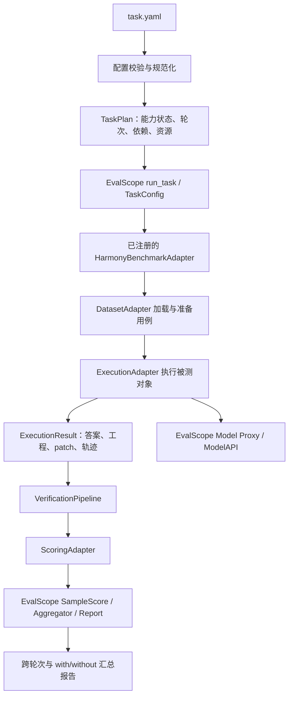

# Harmony Eval 通用评测框架设计

状态：v2 通用框架已落地，实际入口、配置格式、自验证范围及外部依赖见 [使用说明](harmony-eval-usage.md)。真实设备、AGC 服务及真实库转换仍需对应环境和模型凭据验证。

本文基于当前 `config/task.yaml` 的字段和注释、仓库已有 Python 执行器，以及本机安装的 EvalScope 1.14.1 核心代码。原有 `harmony_eval` 是 MultiDev 到 Autorun 的配置转换层；现已增加注册式数据集/目标/执行/评估流程/评分适配器，并直接接入 EvalScope 的 DefaultEvaluator 生命周期。

## 1. 已确认的要求

- 命令保留 `harmony-eval run ./config/task.yaml`。
- 支持一多适配、三方库转鸿蒙库、安卓应用转鸿蒙、MCP 知识库、HTTP 智能问答。
- 三方库转换能力既可以由 Skill 提供，也可以由 OpenCode Plugin 提供，或使用 HarmonyBot 内的指定 Agent。
- HarmonyBot 通过 `execution.agent_name` 切换能力；不得只接受一多 Agent。
- 标准 OpenCode 支持正式的 `opencode_agent` 目标类型，通过运行配置和 `agent_name` 选择已注册 Agent。
- 数据集、验证流程、评分规则都可独立扩展，增加一种验证器不修改总调度流程。
- 保留现有 YAML 字段；必要时增加字段或调整字段语义，通过配置规范化兼容旧字段。
- `static_eval` 暂时保留，**不执行、不计分**，后续单独定义；执行计划明确显示其为预留配置。
- 评测 `harmonybot_agent` 时直接评指定 Agent，**不生成 without 组**。
- 评测 Agent 有无 MCP 知识库时，仍使用 harmonybot_agent 或 opencode_agent，保留相同 Agent，仅通过该引擎的 opencode.json 开关目标 MCP。
- 原先确认的 MultiDev 评分预设仍可用：L1 构建及功能是否全部通过；L2 UITest 通过率代表 UX，占 50%，白盒维度按比例扣分占 50%；L3 直接取白盒总分。新任务允许显式更换分数来源。

## 2. 核心模型：场景、数据、宿主、被测能力分别配置

`scenario` 表达任务意图和选择默认预设；`dataset.type` 只决定用例格式的解析方式；`target.type` 决定被测对象及其装载方式；`execution.engine` 决定运行引擎。

这样，同一套文本问答数据可以评 MCP、HTTP Agent 或 OpenCode Agent，同一个转换用例集也可以比较 Skill 和 Plugin 实现。不能让数据集类型唯一决定整个任务如何执行。

| 场景 | 数据集适配器 | 被测对象 | 宿主/执行方式 | 主要输出与验证 |
|---|---|---|---|---|
| 一多适配 | `swe-bench-hm-multi-dev` | `harmonybot_agent` | HarmonyBot 的一多 Agent | 修改工程、patch；UITest、CloudTest、白盒 |
| 三方库转鸿蒙库 | `library-migration` | `skills` / `plugin_agent` / `harmonybot_agent` | OpenCode + 指定能力 | 鸿蒙库源码、可选 HAR；构建、API 映射、单测、白盒 |
| 安卓应用转鸿蒙 | `android-migration` | `harmonybot_agent` / `plugin_agent` / `skills` | OpenCode 或 HarmonyBot 中的转换 Agent | 新鸿蒙应用、可选 HAP；构建、行为测试、UI 一致性 |
| Agent 有无 MCP 知识库 | `text-qa` | `harmonybot_agent` / `opencode_agent` | 同一个 Agent，使用不同 MCP 配置的 opencode.json | 文本答案、工具调用轨迹；正确性、依据与引用 |
| 智能问答 | `text-qa` | `knowledge`，使用同名配置块 | 请求后端 Agent 的 URL | 文本/结构化答案；规则匹配、LLM Judge |
| 标准 OpenCode 指定 Agent | 上述工程或文本数据集 | `opencode_agent` | OpenCode 中已注册的 Agent | 按数据集选择相应产物与验证器 |

字段含义明确区分：

| target.type | 生效的顶层配置块 | 用途 |
|---|---|---|
| knowledge | knowledge | 智能问答，本场景请求后端 Agent URL |
| harmonybot_agent / opencode_agent | 同名块 | 选择实际执行的 Agent；有无 MCP 通过 execution.opencode.config_path 指向的 OpenCode 配置控制 |
| knowledge_agent | 历史模板预留块 | 保留原字段，不作为本地 OpenCode/HarmonyBot 的 MCP 评测入口 |
| http_agent | http_agent | 通用 HTTP Agent 请求，复用相同 HTTP 协议适配器 |

knowledge 继续表示智能问答。MCP 是执行引擎的配置项，统一放在 opencode.json 的 mcp 节点；本地 Agent 有无知识库的评测不需要再包一层 host_target，也不在 YAML 中重复维护 MCP 配置。

此处安卓迁移的输入按最新需求定义为**待转换安卓应用**。当前 YAML 注释中的“鸿蒙工程”应在实施时修正。

相同 Agent 有无 MCP 的两次运行也可以使用 android-migration 数据集，比较迁移产物；使用 text-qa 时比较答案质量。两种情况都由执行该 Agent 的目标块控制，scenario: KnowledgeEval 只标记评测意图。

## 3. EvalScope 的实际接入方式

阅读的核心位置包括 `run.py`、`api/registry.py`、`api/benchmark/benchmark.py`、`DefaultDataAdapter`、`DefaultEvaluator`、`Model/ModelAPI`、`Metric/Score/Aggregator`，以及外部 Agent 的 OpenCode Runner 和模型代理。

这里有三个需要准确区分的接口：

1. EvalScope `Evaluator` 负责整个数据集的执行、缓存、评分与报告生命周期。它不是 UITest、CloudTest 这样的一个检查步骤。
2. EvalScope `DataAdapter` 不仅加载数据，还提供 `run_inference()`、`calculate_metrics()`、`aggregate_scores()` 等入口。我们在这些入口组合自己的数据、执行、验证和评分组件。
3. EvalScope `Metric.apply()` 主要接受 prediction/reference。工程验证会涉及项目目录、设备、patch 和证据文件，因此不能把所有工程验证器直接套成字符串指标。需要先产生结构化验证结果，再转换为 EvalScope `Score` / `SampleScore`。

当前 EvalScope 的 `create_evaluator()` 按 benchmark 名称查找注册的 Evaluator，否则使用 DefaultEvaluator；不能简单把 YAML 每个 `verification.type` 都当成一个 EvalScope Evaluator 注册进去。

建议结构：



对应关系如下：

| 配置/职责 | 项目组件 | EvalScope 接入点 |
|---|---|---|
| `dataset.type` | 数据集适配器注册表 | `register_benchmark(BenchmarkMeta(...))`、`load_dataset()` |
| `target`、`execution` | TargetRecipe、ExecutionAdapter | `run_inference()`；可复用外部 Agent Runner 协议 |
| `verification` | 评估流程适配器注册表和依赖调度器 | 由 `calculate_metrics()` 调用 |
| `scoring.type` | 评分器注册表 | 返回 `Score` / `SampleScore`；纯文本指标可复用 `register_metric` |
| 跨用例、轮次汇总 | Aggregator、ComparisonReporter | `register_aggregation`、`aggregate_scores()`、报告接口 |
| 模型兼容调用 | EvalScope Model 与模型代理 | 正式执行和 Judge 都使用，超出“运行前探测” |

默认复用 DefaultEvaluator 的样本调度和缓存。不复制一套通用线程池，也不同时运行旧 `run_batch` 的整批调度。旧代码拆出单用例执行、设备验证、白盒验证等可复用组件后接入。

TaskPlan 确定本次 with/without 能力状态并展开轮次，EvalScope 负责样本调度；without_enable 不自动生成另一组任务。初版将 EvalScope `repeats` 固定为 1，避免和 YAML `rounds` 双重展开。

## 4. 四类可扩展接口和统一结果

以下为职责示意；实际可扩展协议与注册表见 src/harmony_eval/core.py 和各适配器模块，不是 EvalScope 原有 API：

```python
class DatasetAdapter:
    def load(self, config) -> list[EvalCase]: ...
    def prepare(self, case, workspace) -> PreparedCase: ...

class ExecutionAdapter:
    async def execute(self, public_case, target, context) -> ExecutionResult: ...

class VerificationAdapter:
    def requirements(self, config) -> Requirements: ...
    async def verify(self, case, execution, dependencies, context) -> VerificationResult: ...

class ScoringAdapter:
    def score(self, case, execution, verification_results, config) -> ScoreResult: ...
```

各接口均有名称、版本、参数 Schema、输入输出能力声明。注册方式同时支持内置装饰器和 Python package entry points。第三方扩展包安装后即可被 YAML 引用，不在核心文件维护不断增长的 if/else。

配置基础 Schema 只约束 `type/id` 等公共字段；具体参数由查到的适配器提供 Schema，避免新增验证器还要修改中央枚举。适配器实例可被并发调用，样本状态放入独立 context，不能存入共享的 `self.current_case`。

统一记录至少包括：

| 记录 | 核心字段 |
|---|---|
| `EvalCase` | 稳定 case_id、input_kind、公开提示词、输入工程、验收要求、评估专用参考资料 |
| `ExecutionResult` | 状态、失败类别、答案、输出工程/patch/包的引用、轨迹引用、耗时、可获得的 token 用量 |
| `VerificationResult` | verifier_id、状态、metrics、dimensions、findings、evidence、原始工具输出引用 |
| `ScoreResult` | dimension、score、max_score、status、扣分明细、证据引用、评分器版本 |
| `ResolvedTarget` | engine/版本、Agent ID、Skill/Plugin/MCP 清单、配置与能力指纹 |

评分器读取稳定的结构化字段，不依赖扫描某个目录里恰好存在的 `result.json`。

## 5. 数据集适配

### 5.1 一多用例兼容现有目录

保留 `base/` 或 `task/`、`PROMPT.md`、`metadata.json`、`test_patch.patch`、`golden_patch.patch` 的已有格式，由一多适配器转换为 EvalCase。

测试补丁、参考答案和其他评估专用文件仅在评估侧使用。Agent 输入只包含完成任务需要的工程与提示词。工程生成完成后固定源码快照，再应用测试补丁或安装依赖，避免测试/安装改动混入 Agent 的 change.patch。

### 5.2 转换类用例

新增轻量 `case.yaml` 描述原工程、转换要求及验收资料；无需伪装成一多用例的 base/task 结构。

```yaml
id: image-library-example
input:
  project: ./source
  instruction: ./PROMPT.md
expected:
  api_mapping: ./grading/api-mapping.yaml
  tests: ./grading/tests
```

产物类型由提示词确定，不再配置 expected.output_kind/output_project。各工程用例统一在自身产物目录的 base/ 中生成目标工程，Agent 的工作目录也是 base/，构建与评分从这里读取工程。不同用例和不同轮次各自隔离。迁移任务自动附加该目录约定；提供 input.target_template 时，目标模板放在 base/，原工程副本放在同级 input/。一多 Web 组合用例在 base/ 下保留原有容器工程与 web/ 的关系，由适配器定位内部容器工程。

源语言、构建命令、支持的 API 和功能验收来自元数据。缺少行为测试时可以给出构建、接口覆盖和白盒结果，但报告必须体现功能验证覆盖不足，不能仅凭编译成功判定转换完全正确。

### 5.3 文本用例

支持 JSONL 等本地格式，先提供一个 `text-qa` 适配器：

```json
{"id":"qa-001","question":"折叠屏悬停态如何组织布局？","reference_answers":["..."],"criteria":["解释状态判断","给出适用 API"],"reference_documents":["grading/doc-001.md"]}
```

reference_answers 可选；缺少参考答案时按明确 rubric 评价，标识参考证据覆盖情况。相同问答数据可用于知识库和 HTTP Agent，不重复定义数据格式。

## 6. OpenCode：引擎、能力装载、Agent 选择分开

统一 `OpenCodeExecutionAdapter`，通过运行发行版适配器区分标准 OpenCode 与 HarmonyBot 内置版本。能力组合器负责生成每个变体的有效配置。

```yaml
execution:
  engine: opencode
  agent_name: d2h
  enviroment:                     # 执行所需的工具链环境
    deveco_home: /Applications/DevEco-Studio.app/Contents
    flutter_home: /path/to/flutter
  opencode:
    # binary: /path/to/opencode   # 标准 OpenCode 可显式指定；HarmonyBot 从 target.dir 定位
    config_path: ./opencode.json  # MCP 等引擎配置从这里读取
    skills:
      - id: conversion-skill
        path: /path/to/skill
        activation: auto         # 或 required
```

上例展示可选的宿主配置。评测 Plugin 时只在 `target` 声明插件：`type: plugin_agent`、`dir: /path/to/package`。入口默认读取包的 `package.json.main`，未声明时使用 `index.js`；特殊入口和初始化选项可分别填写 `target.entry`、`target.options`，不在 execution.opencode 中重复声明被测插件。使用 PATH 中的独立 OpenCode 和默认配置时，整个 execution.opencode 块可省略。

`execution.engine` 选择执行器；`execution.enviroment` 声明该执行器和 Agent 所需的工具链环境，例如 deveco_home、flutter_home，以及可选的 sdk_home、java_home。适配器将这些路径转换为进程环境和 PATH，并在执行前检查需要的工具是否存在。具体任务不需要的 SDK 可以省略。

HarmonyBot 或标准 OpenCode 的启动方式由目标适配器与目标来源确定，不再声明 distribution。OpenCode 的 binary、config_path 等启动参数放在 execution.opencode；enviroment 只承载执行环境。验证器可以继承这些环境设置，也可以在自身配置中显式覆盖。

对于 HarmonyBot，target.dir 先定位实际生效的 Bundle 配置，评测时在独立运行副本上合并 config_path 的显式配置。只配置 mcp 时保留原有 Plugin、Agent 和 Skill，确保 d2h 仍正常注册。框架应核验最终加载的 MCP 状态，不直接修改已安装插件或共享缓存。

装载规则：

- Skill：按 `SKILL.md` 声明的名称选择；支持一个或多个目标 Skill，依赖显式配置。
- `activation: auto` 评估自然选择和使用 Skill 的整体效果。`required` 增加“已读取目标 Skill”的流程检查；没有实际读取时记为流程不合格。仅配置路径不能声称已使用 Skill。
- Plugin：支持本地包/入口文件和固定版本 npm 包。必须同时控制 config 中的 plugin 列表及 OpenCode 自动发现的 plugins 目录，不能只删除数组中的一个名字。
- MCP：读取 execution.opencode.config_path 指向的 OpenCode JSON 中的 mcp 配置，支持引擎可用的本地/远端方式。检查连接、实际暴露工具、目标 Agent 的工具权限，并记录调用；YAML 不再复制一份 MCP 定义。
- Agent：`agent_name` 使用实际运行时 ID，别名经过映射后解析。预检查询实际已加载 Agent；错误时列出可选项，不在代码里限定某三个 Agent。
- 已检查的本机配置包含 `harmonyos-multi-device`、`d2h`、`hmos-library-adapter-fast`，可作为样例，不能作为全部允许值。
- 每次运行使用独立的配置快照、会话数据库和工作目录。先明确并固定引擎实际生效的配置来源，运行时不再混入其他来源的全局能力；生成执行计划后核验最终装载状态。

Plugin 清单保留明确加载顺序，依赖关系及其注册的 Agent/工具归属写入能力清单。关闭一个 Plugin 后若另一能力的依赖不再满足，预检失败，不能自动补回已关闭的对象。

HarmonyBot 的 Bundle 查找、工具链环境、Agent 注册需要保留专用适配。EvalScope 自带 OpenCode Runner 可复用于兼容的标准 CLI 场景，不能直接假定其能启动 HarmonyBot 的全部能力。

## 7. 模型调用：让 EvalScope 进入正式链路

对于框架控制的 OpenCode/HarmonyBot，建议接入已有 EvalScope Model Proxy：

```text
OpenCode / HarmonyBot
        ↓ Chat Completions 或 Responses
EvalScope Model Proxy（每个样本有独立路由标识）
        ↓
EvalScope Model / ModelAPI
        ↓
execution.model 指定的实际模型服务
```

这样正式 Agent 请求、工具调用相关模型轨迹、用量和 Judge 请求可由 EvalScope 统一接入。保留 OpenCode 本身的 Agent 循环和工具执行。

模型代理的路由令牌按样本隔离。初版采用每样本独立 Server/会话，能力资源快照可以共享；不允许多个并发样本在同一 Server 上修改全局 Provider 令牌。只有验证了运行时支持请求级模型凭证后，才引入更细的 Server 复用。

模型代理、外部 Runner 等接口放在 `compat/evalscope` 中封装。以已验证的 1.14.x 为初始兼容范围，锁定版本并做接口契约检查；当前 `>=1.1,<2` 的宽范围需要收窄。

需要验证 HarmonyBot 主会话、子 Agent 和辅助模型请求均经过指定代理；若有插件绕过配置直接访问模型服务，应在运行清单里标为未纳管调用，不能宣称模型已完全统一。

HTTP 后端是不可控的远端 Agent 时，框架仅统一请求、返回和评分。除非后端协议支持指定模型及返回轨迹，否则模型、token、内部工具调用应标记 unknown，不伪造数据。

HTTP 目标拟通过注册的 `HttpAgentModelAPI` 包装请求/响应协议接入 EvalScope；ExecutionAdapter 每个样本只触发一次这条请求链路，用 endpoint/target ID 标识被测系统，避免 LazyModel 把它误当作本地模型下载。这个 ModelAPI 表示整个远端系统，不声称知道内部 LLM。Judge 使用独立配置的真实 Model；目标身份与内部生成模型身份分别记录。

## 8. without_enable：本次运行是否加载被测能力

`without_enable` 直接决定当前这次运行的能力状态，不自动生成两组任务：

- 对 Skill/Plugin 目标，false（默认）加载目标能力，true 不加载目标能力，只运行当前指定的一组。
- 对 Agent 有无 MCP 的任务，MCP 状态直接由 OpenCode JSON 的 enabled 决定；without_enable 不承担 MCP 开关功能。

Skill/Plugin 对比时，分别设置 without_enable 为 false、true 运行两次。Agent 的 MCP 对比时，YAML 保持相同，仅修改 opencode.json 中目标 MCP 的 enabled 运行两次；再按 case_id 和轮次汇总两个运行结果。数据集不复制。

| target.type | 配置位置 | true 时的行为 |
|---|---|---|
| `skills` | skills.execution.without_enable | 不加载被选中的目标 Skill，保留公共宿主能力 |
| `plugin_agent` | plugin_agent.execution.without_enable | 不加载目标 Plugin，也不保留它注册的 Agent、工具或注入内容 |
| `harmonybot_agent` | 不配置 without_enable | MCP 的有无只读取 opencode.json 的 mcp.<server>.enabled |
| `opencode_agent` | 不配置 without_enable | MCP 的有无只读取 opencode.json 的 mcp.<server>.enabled |
| `knowledge` / `http_agent` | 不启用 without | 智能问答或通用 HTTP 请求；如需对比不同后端，分别配置任务 |

Skill/Plugin 目标适配器根据 target.dir 和选择清单识别被测能力及其归属，开关该能力时不需要额外的禁用清单。MCP 清单则来自引擎实际加载的 OpenCode 配置。公共宿主能力必须单独声明，不能与目标能力混在一起随意删除。

`execution.agent_name` 始终表示本次实际执行的 Agent。目标 Plugin 关闭后，如果该 Agent 也由它注册，就无法继续使用该 Agent：without 配置应选择仍存在的宿主 Agent，例如 build。预检发现缺失时明确报错，不自动回退或保留已关闭插件的 Agent 定义。

```yaml
plugin_agent:
  execution:
    engine: opencode
    agent_name: build
    without_enable: true    # 本次不加载目标 Plugin
```

Agent 有无知识库的两次运行保持同一 target.type 和 agent_name，YAML 保持不变，只在实际加载的 opencode.json 或其独立副本中修改目标 MCP 的 enabled。配置的关键不变量必须在执行计划中记录，报告比较时核验样本、公开提示词、模型参数、宿主能力和工具预算。

每个执行单元以 (task_id, run_id, round, case_id) 唯一标识，报告记录 Skill/Plugin 开关和每个 MCP 的最终 enabled 状态；MCP 状态不从 without_enable 推断。展示名称不参与身份判定。跨运行比较按 case_id 和轮次配对；模型服务不支持 seed 时明确记录。

MCP 的“加载成功”和“用到了知识”分开记录：available、attempted、succeeded、是否引用返回资料。自然调用和强制调用是不同实验条件，需要分别命名。有无 MCP 的运行采用相同中性问题，避免额外提示影响对照。

原模板的 knowledge_agent、host_target 和 without_process 暂保留为历史预留字段，不增加新的执行入口。本地 OpenCode/HarmonyBot 的 MCP 评测不使用这层包装，也不需要删除知识文件的脚本。若任务选择预留的 knowledge_agent 类型，预检应提示改用实际运行的 harmonybot_agent 或 opencode_agent。

## 9. VerificationPipeline：新增评估流程不改框架

`verification` 的每个条目代表一套评估流程，例如 UITest、CloudTest、whiteboxeval、LLM_judge；`type` 选择流程适配器，`id` 用于引用该流程的结果。编译、安装、启动等操作由需要它们的评估流程内部组织，不作为独立的 verification 条目。

例如 UITest 流程内部完成测试工程准备、编译、安装、执行和结果收集，输出 build_passed、all_tests_passed、pass_rate 等指标；LibraryTests 流程内部准备并编译库及测试工程，再运行测试。编译失败时由所属流程记录失败阶段、指标和证据；工具不可用等基础设施异常仍单独标记。可复用的编译服务属于流程内部组件，任务 YAML 无需声明 build 节点或对它的依赖。

每个评估流程拥有独立 `id` 和 `type`。允许同一 type 多次使用，例如用两个模型分别做不同的 LLM Judge；旧 YAML 中未写 id 且 type 唯一时自动生成 id。

```yaml
verification:
  - id: ui
    type: UITest
    deveco_home: /Applications/DevEco-Studio.app/Contents
    emulator_deployed_dir: /path/to/emulators
  - id: code
    type: whiteboxeval
  - id: answer_judge
    type: LLM_judge
    input: execution.answer
    prompt_path: ./rubrics/qa.md
```

这只是字段示例；工程任务和文本任务各自选择适用检查。没有“所有场景必须 UITest”的全局规则。

依赖调度器提供：

- 校验节点存在、无环、输入产物满足要求。
- 不同验证器可并行；修改工程的验证器使用各自工作副本。
- 设备按设备 ID 串行占用；编译、云提交、Judge 有各自并发预算。
- 云测试节点自行提交、轮询、收集结果，总调度器不认识云服务特有状态。
- 验证器返回失败和工具执行异常分开记录；依赖缺失时节点 skipped/unavailable，并给出原因。

首批评估流程包括当前 UITest、CloudTest、whiteboxeval、LLM_judge，以及三方库初版的 LibraryAPICount。三方库示例先输出分类 API 数量一致率与白盒 L3；LibraryAPICompatibility、LibraryTests 保留为后续映射与功能验收扩展，不要求初版提供这些资料。API 数量检查在 Agent 执行前冻结原库清单，使用语法树提取，输出三类数量和逐项声明，数量一致不表示接口等价或功能正确。AGCDetection 需要独立协议和返回结构定义，不与 CloudTest 仅因名称相近而合并。depends_on 仅表达评估流程之间实际存在的结果依赖，不用于拆分编译、安装等流程内部步骤。

`whiteboxeval.rubric_path` 支持为库转换和应用迁移显式选择评分标准；`LLM_judge.prompt_path` 定义问答评价要求。`ToolUsage.mode: observe` 只采集能力可用性和调用情况，不把对照组预期关闭的能力判为业务失败。

验证器也可以由 Skill 提供，使用通用 `SkillVerifier`：单独启动评估会话，加载指定验证 Skill，输入工程快照及证据，按 JSON Schema 产出 VerificationResult。它不复用被测 Agent 的会话或上下文，结果结构校验失败则 unavailable。

仅新增验证流程时可以写组合工作流 YAML；新增工具能力时只新增验证器实现及注册，不改核心调度。耗时外部步骤必须能从已有 ExecutionResult 重做，避免重新执行 Agent。

## 10. Scoring：层级名不绑定验证器

`L1/L2/L3` 是报告维度名称。各自的数据来源由 `source` 或 `components` 明确指定，不能在代码里固定 L2 必须是 CloudTest 或必须是 UITest。

`ImmediateValue` 默认直接取值；显式配置 `scale` 时执行单位换算，例如将 0～1 的通过率乘以 100。单位换算不改变原验证指标。

因此 YAML 注释中的“L1→UITest、L2→CloudTest、L3→whiteboxeval”可以配置出来；之前确认的一多 L2 口径也可以配置出来。

```yaml
scoring:
  - dimension: L1
    type: BooleanScoring
    all:
      - {source: ui.metrics.build_passed, equals: true}
      - {source: ui.metrics.all_tests_passed, equals: true}
    pass_score: 100
    fail_score: 0

  - dimension: L2
    type: WeightedSummation
    mode: deduction
    base_score: 100
    components:
      - name: UX
        source: ui.metrics.pass_rate
        range: [0, 1]
        weight: 0.5
      - name: Whitebox
        source: code.dimensions
        reducer: proportional_deduction
        cap_source: code.metrics.total_score
        weight: 0.5
    missing: unavailable

  - dimension: L3
    type: ImmediateValue
    source: code.metrics.total_score
```

按当前一多预设，负分制的确定性公式为：

```text
UX 扣分 = 50 × (1 - UITest 通过率)
白盒维度 i 的分配分 = 50 × 该维度满分 / 全部维度满分
白盒维度 i 扣分 = 分配分 × (1 - 维度得分 / 维度满分)
白盒贡献再受已有白盒最终总分上限约束，保留硬门槛效果
L2 = 100 - UX 扣分 - 白盒扣分
L3 = 白盒最终总分
```

白盒已经做过的规则扣分不得重复扣除。每条分数保存来源、分配、扣分、封顶和证据，评分结果可复算。

纯文本任务可通过 EvalScope 已有 Exact Match、语义/LLM Judge 等能力产生指标，再由相同评分器聚合。LLM Judge 只负责产出有依据的评价结果；最终加权计算交给确定性代码。

知识库答案评分优先使用固定版本的权威参考资料，Judge 不接收 with/without 标签。目标 MCP 的返回内容是待核验证据，不能无条件作为唯一正确答案。

真实断言失败可以为 0 分；设备连接、模型接口或裁判异常造成的缺证据，默认 unavailable。报告同时显示全部样本数、已评分数、完成率和得分；with/without 额外使用同一组有效配对样本计算差值，不能通过忽略单边失败得到虚高对照结果。

## 11. YAML 兼容与选择规则

- 增加 `schema_version: 2`；保留 `id/description/scenario/dataset/target`。
- 保留 skills/harmonybot_agent/plugin_agent/http_agent/knowledge 各配置块，增加正式的 opencode_agent 配置块。knowledge_agent 只作为历史模板字段保留，不再要求本地 MCP 任务选择它。
- 根据 `target.type` 选择生效配置块；其他块可保留为模板，除被显式引用的宿主配置外不参与执行。 选择必须按完整类型名精确匹配，不能按 knowledge 前缀或是否为文本数据集判断任务类型。
- target.type: knowledge 选择 knowledge 智能问答配置。Agent 有无 MCP 知识库的评测选择实际执行的 harmonybot_agent 或 opencode_agent，并通过 execution.opencode.config_path 配置 MCP。knowledge_agent 作为历史模板预留，不是当前本地 MCP 评测的入口；knowledge 与它不做别名归一化。http_agent 继续作为通用 HTTP 目标使用同名配置块。
- 各类生效块统一支持 `rounds/execution/verification/scoring/report`，减少不同目标的字段差异。
- 本地 Agent 有无 MCP 的配置不使用 host_target/profile 引用；Agent、模型、执行环境、验证器和评分直接放在当前目标块。历史 knowledge_agent 中的 host_target 字段只保留，不参与这些样例的执行。
- 有效配置优先级为：适配器内置默认值 → 目标发行版的有效配置 → execution.opencode.config_path 的显式配置 → 当前任务显式模型及能力选择。验证器的显式环境参数覆盖执行上下文的默认值。MCP 只在引擎配置里维护一份。
- 同一语义的新旧字段同时出现但冲突时拒绝执行；不依赖 YAML 最后出现的位置决定。
- 模型配置保留 `name/base_url/api_key`，增加/统一 `api_type`。Judge 可独立指定模型；省略时复用执行模型。api_key 支持环境变量名，并兼容直接填写的密钥，明文密钥在加载后转换为进程内引用，运行快照和报告脱敏。
- v2 中 `execution.timeout` 表达单次任务总时限，新增 `idle_timeout` 区分无活动超时；连接、验证器和云轮询分别有自己的超时配置。旧版把 timeout 映射为 idleTimeoutSec 的行为在迁移计划中明确显示，不能悄悄沿用到新协议。
- 旧版一多任务缺少评分 source 时可显式选择 `scoring_preset: multidev-v1`，执行计划展开为完整规则。新版本不靠维度名猜来源。
- 相对路径以 task.yaml 所在目录解析。verification 中已有 `deveco_home/emulator_deployed_dir/flutter_home/test_category/prompt_path` 等字段保留，由对应验证器的参数 Schema 校验和转换。
- Plugin 的 entry 特别约定为相对该 Plugin 的 source 根目录解析；source 缺省时使用 target.dir。Skill 未配置 path 时从 target.dir 按声明名称查找。
- 任务所需参数直接在本份 YAML 中声明：执行器通过 execution.engine 选择，工具链路径放在 execution.enviroment，验证专用的工具路径、设备和服务参数放在对应 verification 条目。适配器可以按已声明的 DevEco 目录推导 SDK、Hvigor、ohpm 和 hdc 路径；缺少必要参数时预检报错，不隐式读取额外的 Autorun JSON 配置。
- execution.enviroment 的工具链字段统一使用 deveco_home、flutter_home、sdk_home、java_home；其中 flutter_home 指向 Flutter SDK 根目录。不需要本地工具链的纯 HTTP/问答任务可省略 enviroment。
- UITest 的 devices 直接声明 id、profile、target、hdc_port、start_emulator 等设备参数。可用 YAML anchor 在执行和验证配置间复用路径；纯文本/HTTP 任务无需配置 DevEco 或设备。
- execution.opencode.config_path 指向 OpenCode 的引擎配置，承载 Agent/Plugin/MCP 等设置，不是另一份任务或机器环境配置。MCP 有无的配置文件除了目标服务器的 enabled 值外应保持一致。
- `CloudTest.test_category` 文本标签通过该验证器的类别映射表转换，无法识别时列出支持值；数字类别仍可直接配置。映射与服务版本绑定。
- `scenario` 和 `target.type` 中斜杠连接的字符串属于模板选项说明，实际任务必须填写一个值。

## 12. 各场景的完整 YAML 示例

以下每个代码块都是一份独立的 task.yaml，包含数据集、目标、执行、验证、评分和报告配置。它们采用已实现的 v2 协议；真实运行前需替换数据集、能力入口、裁判资料、工具链和模型凭据。独立 YAML 文件位于 config/examples/，其相对路径已按所在目录调整。

假设样例保存于仓库 `config/`，则数据集路径 `../datasets/...`、产物路径 `../outputs/...` 均相对此目录解析。执行器的工具链参数写在 execution.enviroment，验证器的设备参数写在对应 verification 条目，都在当前 YAML 中配置。Plugin 的 `entry` 相对该 Plugin 的 source/target.dir 解析；Skill 未填写 path 时从 target.dir 按 name 查找。

示例中的 api_key 使用环境变量名，也兼容直接填写包含连字符、点等字符的密钥。示例里的 YAML anchor 只在当前代码块内复用模型配置；白盒验证器省略 model 即复用执行模型，无需锚点；需要独立裁判模型时可显式填写。`whiteboxeval.rubric_path`、LLM Judge 的 prompt_path 以及其他验收文件需要按任务准备。示意 Agent ID、Skill 名称、Plugin 入口和服务地址需替换为实际值。

| 示例文件名 | 评测内容 | 运行目标 | 本次运行状态 |
|---|---|---|---|
| `task.multidev.yaml` | 一多适配 | HarmonyBot 一多 Agent | 直接评 Agent |
| `task.library-skill.yaml` | 三方库转鸿蒙库 | OpenCode + 指定 Skill | without：不加载目标 Skill |
| `task.library-plugin.yaml` | 三方库转鸿蒙库 | OpenCode + 指定 Plugin | without：不加载目标 Plugin |
| `task.android-migration.yaml` | 安卓应用转鸿蒙 | HarmonyBot 的 d2h Agent | 直接评 Agent |
| `task.opencode-agent.yaml` | 文本问答 | 标准 OpenCode 中指定的 Agent | 直接评 Agent |
| `task.knowledge-harmonybot.yaml` | Agent 有无 MCP 知识库 | harmonybot_agent 中的 d2h | 通过 HarmonyBot 的 OpenCode 配置开关 MCP |
| `task.knowledge-opencode.yaml` | Agent 有无 MCP 知识库 | 标准 OpenCode 的指定 Agent | 通过 OpenCode 配置开关 MCP |
| `task.knowledge-qa.yaml` | 智能问答 | knowledge 块配置的 HTTP 后端 Agent | 直接评后端答案 |

保存相应示例后，入口命令统一为：

```sh
harmony-eval run ./config/task.multidev.yaml
# 其他场景只替换 YAML 文件名。
```

### 12.1 一多适配：HarmonyBot 中指定一多 Agent

数据集继续采用现有 base/PROMPT.md/metadata.json/test_patch.patch 等格式。本例完整展开之前确认的 L1/L2/L3 评分口径。

```yaml
schema_version: 2
scenario: MultiDev
id: multidev-harmonybot
description: 评测 HarmonyBot 一多 Agent 的适配效果

dataset:
  type: swe-bench-hm-multi-dev
  dir: ../datasets/multidev

target:
  type: harmonybot_agent
  dir: /path/to/vscode/extensions

harmonybot_agent:
  rounds: 1
  static_eval: {}                    # 预留，不执行、不计分
  execution:
    engine: opencode
    agent_name: harmonyos-multi-device
    timeout: 900
    idle_timeout: 300
    enviroment:
      deveco_home: &deveco_home /Applications/DevEco-Studio.app/Contents
    model: &model
      api_type: openai_api
      name: qwen-plus
      base_url: https://dashscope.aliyuncs.com/compatible-mode/v1
      api_key: DASHSCOPE_API_KEY
  verification:
    - id: ui
      type: UITest
      deveco_home: *deveco_home
      emulator_deployed_dir: /path/to/emulators
      devices:
        - id: phone
          profile: Pura 90 Pro
          target: 127.0.0.1:15001
          hdc_port: 15001
          start_emulator: true
    - id: code
      type: whiteboxeval
      model: *model
  scoring:
    - dimension: L1
      type: BooleanScoring
      all:
        - {source: ui.metrics.build_passed, equals: true}
        - {source: ui.metrics.all_tests_passed, equals: true}
      pass_score: 100
      fail_score: 0
    - dimension: L2
      type: WeightedSummation
      mode: deduction
      base_score: 100
      components:
        - name: UX
          source: ui.metrics.pass_rate
          range: [0, 1]
          weight: 0.5
        - name: Whitebox
          source: code.dimensions
          reducer: proportional_deduction
          cap_source: code.metrics.total_score
          weight: 0.5
      missing: unavailable
    - dimension: L3
      type: ImmediateValue
      source: code.metrics.total_score
  report:
    output_dir: ../outputs/multidev-harmonybot
    format: html
```

### 12.2 三方库转鸿蒙库：OpenCode 指定 Skill

target.dir 下按 SKILL.md 声明的 name 选择 library-conversion。本例 without_enable 为 true，只运行不加载目标 Skill 的基线；设为 false 后加载该 Skill。两次均使用同一 build Agent。

```yaml
schema_version: 2
scenario: LibraryMigration
id: library-conversion-skill
description: 不加载目标三方库转换 Skill 的基线评测

dataset:
  type: library-migration
  dir: ../datasets/libraries

target:
  type: skills
  dir: ../capabilities/library-skills

skills:
  rounds: 1
  execution:
    engine: opencode
    agent_name: build
    timeout: 1800
    idle_timeout: 300
    without_enable: true
    enviroment:
      deveco_home: &deveco_home /Applications/DevEco-Studio.app/Contents
    model: &model
      api_type: openai_api
      name: qwen-plus
      base_url: https://dashscope.aliyuncs.com/compatible-mode/v1
      api_key: DASHSCOPE_API_KEY
    opencode:
      binary: /path/to/opencode
      skills:
        - id: library-conversion
          name: library-conversion
          activation: auto
  verification:
    - id: api
      type: LibraryAPICount
    - id: code
      type: whiteboxeval
      model: *model
      rubric_path: ./rubrics/library-migration.yaml
  scoring:
    - dimension: api_count_consistency
      type: ImmediateValue
      source: api.metrics.count_consistency
      scale: 100
    - dimension: L3
      type: ImmediateValue
      source: code.metrics.total_score
  report:
    output_dir: ../outputs/library-conversion-skill
    format: html
```

### 12.3 三方库转鸿蒙库：OpenCode 装载指定 Plugin

本例 without_enable 为 true，不加载目标 Plugin，使用宿主 build Agent 完成任务。设为 false 后加载目标 Plugin；若要测试它专有的 Agent，再将 agent_name 指定为插件实际注册的 ID。若 Plugin 增强的是现有 build Agent，两次可以保持同一 Agent。

```yaml
schema_version: 2
scenario: LibraryMigration
id: library-conversion-plugin
description: 不加载目标三方库转换 Plugin 的基线评测

dataset:
  type: library-migration
  dir: ../datasets/libraries

target:
  type: plugin_agent
  dir: ../capabilities/library-plugin
  entry: ./dist/index.js

plugin_agent:
  rounds: 1
  static_eval: {}
  execution:
    engine: opencode
    agent_name: build
    timeout: 1800
    idle_timeout: 300
    without_enable: true
    enviroment:
      deveco_home: &deveco_home /Applications/DevEco-Studio.app/Contents
    model: &model
      api_type: openai_api
      name: qwen-plus
      base_url: https://dashscope.aliyuncs.com/compatible-mode/v1
      api_key: DASHSCOPE_API_KEY
  verification:
    - id: api
      type: LibraryAPICount
    - id: code
      type: whiteboxeval
      model: *model
      rubric_path: ./rubrics/library-migration.yaml
  scoring:
    - dimension: api_count_consistency
      type: ImmediateValue
      source: api.metrics.count_consistency
      scale: 100
    - dimension: L3
      type: ImmediateValue
      source: code.metrics.total_score
  report:
    output_dir: ../outputs/library-conversion-plugin
    format: html
```

如果直接评 HarmonyBot 内置的三方库转换 Agent，则使用 `target.type: harmonybot_agent`、`agent_name: hmos-library-adapter-fast`，并将上例验证和评分配置放到 harmonybot_agent 块；数据集保持 library-migration。

### 12.4 安卓应用转鸿蒙：HarmonyBot 中指定 d2h Agent

输入为安卓应用工程。UITest 评估流程针对 Agent 生成的鸿蒙工程，内部完成编译、安装和测试，测试与验收预期由各 case 提供。verification 仅配置评估流程，不单独配置编译步骤。

```yaml
schema_version: 2
scenario: AndroidMigration
id: android-migration-harmonybot
description: 评测 HarmonyBot 安卓转鸿蒙 Agent

dataset:
  type: android-migration
  dir: ../datasets/android-apps

target:
  type: harmonybot_agent
  dir: /path/to/vscode/extensions

harmonybot_agent:
  rounds: 1
  static_eval: {}
  execution:
    engine: opencode
    agent_name: d2h
    timeout: 3600
    idle_timeout: 300
    enviroment:
      deveco_home: &deveco_home /Applications/DevEco-Studio.app/Contents
    model: &model
      api_type: openai_api
      name: qwen-plus
      base_url: https://dashscope.aliyuncs.com/compatible-mode/v1
      api_key: DASHSCOPE_API_KEY
  verification:
    - id: ui
      type: UITest
      deveco_home: *deveco_home
      emulator_deployed_dir: /path/to/emulators
      devices:
        - id: phone
          profile: Pura 90 Pro
          target: 127.0.0.1:15001
          hdc_port: 15001
          start_emulator: true
    - id: code
      type: whiteboxeval
      model: *model
      rubric_path: ./rubrics/android-migration.yaml
  scoring:
    - dimension: L1
      type: BooleanScoring
      all:
        - {source: ui.metrics.build_passed, equals: true}
        - {source: ui.metrics.all_tests_passed, equals: true}
      pass_score: 100
      fail_score: 0
    - dimension: L2
      type: ImmediateValue
      source: ui.metrics.pass_rate
      scale: 100
    - dimension: L3
      type: ImmediateValue
      source: code.metrics.total_score
  report:
    output_dir: ../outputs/android-migration-harmonybot
    format: html
```

### 12.5 标准 OpenCode：直接指定一个 Agent

`opencode_agent` 为正式目标类型。`qa-agent` 必须由指定 config_path 的运行配置注册；该配置中的能力也写入有效能力清单。更换 agent_name 即可评另一个已注册 Agent。

```yaml
schema_version: 2
scenario: QuestionAnswering
id: opencode-selected-agent
description: 使用文本问题评测 OpenCode 中指定的 Agent

dataset:
  type: text-qa
  dir: ../datasets/qa

target:
  type: opencode_agent

opencode_agent:
  rounds: 1
  execution:
    engine: opencode
    agent_name: qa-agent
    timeout: 120
    model: &model
      api_type: openai_api
      name: qwen-plus
      base_url: https://dashscope.aliyuncs.com/compatible-mode/v1
      api_key: DASHSCOPE_API_KEY
    opencode:
      binary: /path/to/opencode
      config_path: ./runtime/opencode-agents.json
  verification:
    - id: qa
      type: LLM_judge
      model: *model
      prompt_path: ./rubrics/answer-quality.md
  scoring:
    - dimension: answer_quality
      type: ImmediateValue
      source: qa.metrics.score
  report:
    output_dir: ../outputs/opencode-selected-agent
    format: html
```

如该 Agent 用于工程任务，则替换 dataset，并选择相应工程验证器；执行器仍使用相同的 OpenCode 适配。

### 12.6 HarmonyBot 的 d2h Agent：通过 opencode.json 配置有无 MCP

这仍然是 harmonybot_agent 任务，agent_name 为 d2h。知识库是 HarmonyBot 的 OpenCode 配置中的 MCP，YAML 仅指定要加载的配置文件，不使用 knowledge_agent 或 host_target 包装。

```yaml
schema_version: 2
scenario: KnowledgeEval
id: harmonybot-d2h-mcp
description: 比较同一 HarmonyBot d2h Agent 在有无 MCP 时的答案质量

dataset:
  type: text-qa
  dir: ../datasets/knowledge-qa

target:
  type: harmonybot_agent
  dir: /path/to/vscode/extensions

harmonybot_agent:
  rounds: 1
  static_eval: {}
  execution:
    engine: opencode
    agent_name: d2h
    timeout: 120
    opencode:
      config_path: ./opencode/harmonybot.json
    model: &model
      api_type: openai_api
      name: qwen-plus
      base_url: https://dashscope.aliyuncs.com/compatible-mode/v1
      api_key: DASHSCOPE_API_KEY
  verification:
    - id: qa
      type: LLM_judge
      model: *model
      prompt_path: ./rubrics/knowledge-answer-quality.md
    - id: usage
      type: ToolUsage
      target_mcp: developer_knowledge
      mode: observe
  scoring:
    - dimension: answer_quality
      type: ImmediateValue
      source: qa.metrics.score
  report:
    output_dir: ../outputs/harmonybot-d2h-mcp
    format: html
```

`config/opencode/harmonybot.json`，第一次运行时启用 MCP：

```json
{
  "mcp": {
    "developer_knowledge": {
      "type": "remote",
      "url": "https://example.com/mcp",
      "enabled": true
    }
  }
}
```

第二次运行使用相同 YAML 和相同 JSON 文件，只将目标 MCP 的 enabled 改为 false：

```json
{
  "mcp": {
    "developer_knowledge": {
      "type": "remote",
      "url": "https://example.com/mcp",
      "enabled": false
    }
  }
}
```

分别运行两次，第二次只修改同一 OpenCode 配置文件中的 MCP enabled；YAML、d2h Agent、模型、问题、验证和评分保持相同。这里不配置 without_enable，也不关闭 HarmonyBot Plugin。

config_path 是可选的。已经在 HarmonyBot 实际生效的 opencode.json 中配置 MCP 时，可以省略该字段，直接使用并记录该有效配置；两次只修改目标 MCP 的 enabled 并重新加载。框架保存两次最终生效的配置快照，以复核知识库状态。

这里的 JSON 是对 HarmonyBot 生效配置的补充：框架合并到实际 Bundle 配置的运行副本，保留 d2h 的 Plugin、Agent 定义与其他能力。如果直接复用已有完整的 HarmonyBot opencode.json，也按相同方式读取并记录最终配置；仅修改未生效的源码配置不能作为已经切换的证据。

若评真实安卓应用迁移，将 dataset.type 换成 android-migration，并使用 12.4 的工程验证与评分；MCP 仍然只在 OpenCode 配置中切换。

### 12.7 标准 OpenCode：通过 opencode.json 配置有无 MCP

本例是普通 opencode_agent 任务，由标准 OpenCode 的同一个 build Agent 回答文本问题。YAML 只指定引擎、Agent 和它加载的 opencode.json，不配置知识库包装、host_target、MCP 定义或 without_enable。scenario: KnowledgeEval 仅标记评测目的，不改变执行入口。ToolUsage 是可选的调用观测步骤，不控制 MCP。

```yaml
schema_version: 2
scenario: KnowledgeEval
id: opencode-agent-mcp
description: 比较同一 OpenCode Agent 在有无 MCP 时的答案质量

dataset:
  type: text-qa
  dir: ../datasets/knowledge-qa

target:
  type: opencode_agent

opencode_agent:
  rounds: 1
  execution:
    engine: opencode
    agent_name: build
    timeout: 120
    opencode:
      binary: /path/to/opencode
      config_path: ./opencode/opencode.json
    model: &model
      api_type: openai_api
      name: qwen-plus
      base_url: https://dashscope.aliyuncs.com/compatible-mode/v1
      api_key: DASHSCOPE_API_KEY
  verification:
    - id: qa
      type: LLM_judge
      model: *model
      prompt_path: ./rubrics/knowledge-answer-quality.md
    - id: usage
      type: ToolUsage
      target_mcp: developer_knowledge
      mode: observe
  scoring:
    - dimension: answer_quality
      type: ImmediateValue
      source: qa.metrics.score
  report:
    output_dir: ../outputs/opencode-agent-mcp
    format: html
```

`config/opencode/opencode.json`，第一次运行时启用 MCP：

```json
{
  "mcp": {
    "developer_knowledge": {
      "type": "remote",
      "url": "https://example.com/mcp",
      "enabled": true
    }
  }
}
```

第二次使用相同 YAML、相同 opencode.json，只将目标 MCP 的 enabled 改为 false：

```json
{
  "mcp": {
    "developer_knowledge": {
      "type": "remote",
      "url": "https://example.com/mcp",
      "enabled": false
    }
  }
}
```

两次运行的 YAML 完全相同，无需额外配置文件或新目标类型；MCP 状态完全由这个 opencode.json 决定。config_path 仍为可选项，省略时使用当前 OpenCode 的生效配置。若指定自定义 Agent，在两次运行中保留它的相同定义；框架核验配置差异仅为目标 MCP 的 enabled。

### 12.8 智能问答：knowledge 配置请求 URL 后端的 Agent

knowledge 表示智能问答，使用 HTTP 请求后端 Agent，与 12.6/12.7 中配置了 MCP 的本地 Agent 任务分别配置。本例为同步 JSON 协议，POST 问题后从 data.answer 取答案。后端生成模型由服务管理；verification.model 单独声明裁判模型。

```yaml
schema_version: 2
scenario: QuestionAnswering
id: knowledge-http-qa
description: 评测 HTTP 后端 Agent 的问答质量

dataset:
  type: text-qa
  dir: ../datasets/qa

target:
  type: knowledge

knowledge:
  rounds: 1
  execution:
    engine: http
    http_url: https://example.com/agent/answer
    method: POST
    timeout: 120
    request:
      headers:
        Authorization: 'Bearer ${env:AGENT_TOKEN}'
      json:
        question: '${case.question}'
    response:
      protocol: json
      answer_path: data.answer
      session_id_path: data.session_id
  verification:
    - id: qa
      type: LLM_judge
      prompt_path: ./rubrics/answer-quality.md
      model:
        api_type: openai_api
        name: qwen-plus
        base_url: https://dashscope.aliyuncs.com/compatible-mode/v1
        api_key: DASHSCOPE_API_KEY
  scoring:
    - dimension: answer_quality
      type: ImmediateValue
      source: qa.metrics.score
  report:
    output_dir: ../outputs/knowledge-http-qa
    format: html
```

如评测通用 HTTP Agent，可同时将上例的 target.type 和顶层配置块名改为 http_agent，其他请求/响应与评分配置不变；knowledge 不会被当作本地 Agent 的 MCP 配置块。

HTTP 的 JSON、SSE、异步提交/轮询分别由协议适配器实现。`${...}` 仅支持白名单变量替换。默认每个样本独立会话；多轮用例显式声明会话组，只有后端实际返回 session_id 时才配置对应提取字段。

## 13. 输出、缓存与复评

```text
report.output_dir/<run_id>/
  task.resolved.yaml          # 脱敏后的有效任务、能力清单及版本
  task-report.json
  index.html
  variants/<variant>/round-01/
    cases/<case_id>/
      generate/              # Agent 答案、日志、轨迹；工程结果按场景保存
      change.patch           # 修改既有工程时；迁移可为新增工程清单
      verification/<id>/     # 必要证据和外部工具原始输出
```

以统一汇总数据作为报告源，验证器只保留复核所需的证据文件，不再为统一对象重复生成多个用途重叠的 JSON。EvalScope 缓存文件通过适配层管理，不额外复制一份；后续可重建的中间物使用系统临时目录。

缓存按阶段区分：执行缓存由输入、被测目标和模型设置决定；验证缓存再加入验证器与工具版本；评分缓存再加入规则版本。规则修改可从已有验证结果重新计算，验证规则变更可复用 Agent 产物。缓存失配要明确说明，不能串用不同 with/without 的结果。

建议增加 `plan`、`verify`、`rescore` 命令；`run` 仍为主入口。它们是使用已有结果的阶段操作，不自动恢复已删除的“失败用例重试”功能。

报告支持场景标签，但界面由实际指标生成；不能写死“所有任务都有 L1/L2/L3”。对照报告同时展示得分变化、执行成功率、配对覆盖率和能力实际调用情况。

## 14. 建议代码结构与实施顺序

```text
src/harmony_eval/
  cli.py
  config/         # YAML Schema、旧字段兼容、TaskSpec、TaskPlan
  compat/         # EvalScope 版本边界与公共数据转换
  datasets/       # 一多、库迁移、安卓迁移、文本问答
  targets/        # Skill/Plugin/HarmonyBot/Knowledge/HTTP 的装载规则
  execution/      # OpenCode、HarmonyBot 发行版、HTTP 协议、模型代理
  verification/   # 注册表、依赖流程、各验证器
  scoring/        # 注册表、Boolean/Weighted/Immediate、汇总
  reporting/      # 通用报告与对照视图
```

实施顺序：

1. 建立 TaskSpec、接口契约和注册表；接入 EvalScope 原生生命周期，将已有一多行为迁移进去并验证结果口径一致。
2. 实现 OpenCode 能力组合、任意 Agent 选择和 Skill/Plugin 对照；建立可复用的模型代理链路。
3. 接入文本数据集、MCP 知识库和 HTTP 目标，验证这些任务不需要工程和设备也能运行。
4. 接入三方库与安卓迁移用例适配，补构建、API/行为测试和对应报告。
5. 验证独立扩展包新增验证器、组合工作流及评分器，无需修改核心流程。

这是同一方案的交付顺序，最终支持矩阵必须覆盖五类场景，不能只留下类型名称与空实现。

验收至少包含：两种输入类型端到端；切换三个实际 HarmonyBot Agent；Skill 与 Plugin 能加载及关闭；知识库两组仅 MCP 有差异；HTTP 的样本映射与会话隔离；真实失败与基础设施异常区分；相同产物更换评分规则复算；新增扩展不改核心调度。

## 15. 实施时仍需补齐的业务资料

- 三方库和安卓迁移的首批样例工程，以及可用于判断功能正确的测试/预期；框架可支持多种验收方式，但不能凭空产生可信的完整行为规范。
- HTTP Agent 的请求/响应样例、认证和是否流式/异步；声明式协议字段据此校准。
- AGCDetection 的实际服务/工具接口、CloudTest 文本类别对应的服务类别，以及白盒是否覆盖三方库和安卓迁移的 rubric。

这些影响具体适配器和样例，不影响上述框架分层。`static_eval` 的业务定义按确认继续预留。

## 参考实现

- [EvalScope DataAdapter 与贡献基准说明](https://evalscope.readthedocs.io/en/latest/advanced_guides/add_benchmark.html)
- [EvalScope 注册表：Benchmark、Evaluator、Metric、Runner](https://github.com/modelscope/evalscope/blob/main/evalscope/api/registry.py)
- [EvalScope DefaultEvaluator](https://github.com/modelscope/evalscope/blob/main/evalscope/evaluator/evaluator.py)
- [EvalScope Agent 评测说明](https://evalscope.readthedocs.io/en/latest/user_guides/agent/index.html)
- [EvalScope OpenCode Runner](https://github.com/modelscope/evalscope/blob/main/evalscope/agent/external/runners/opencode.py)
- [EvalScope 模型代理](https://github.com/modelscope/evalscope/blob/main/evalscope/agent/external/bridge/server.py)
- [OpenCode Skill 的发现和权限](https://opencode.ai/docs/skills/)
- [OpenCode Plugin 的配置与自动加载](https://opencode.ai/docs/plugins/)
- [OpenCode MCP 的装载和开关](https://opencode.ai/docs/mcp-servers/)
