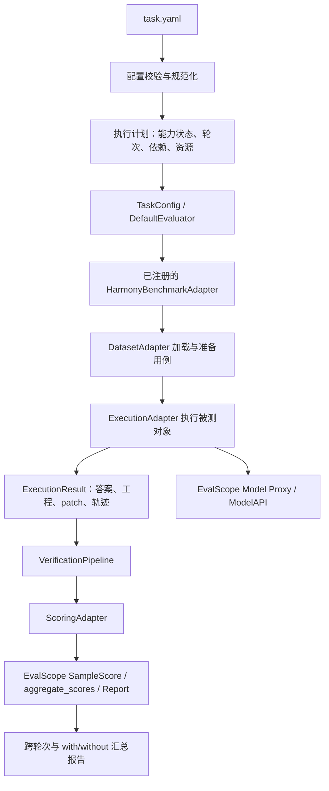

# 通用框架实现参考

本册保存参考仓库的技术细节，配合[重构实施指南](harmony-eval-framework-design.md)使用。实施时按需查阅，不把本册的历史实现顺序当作目标仓库的迁移步骤。

这里的“当前”“已实现”“已移除”和测试数量均指**参考仓库**。目标仓库只是结构类似旧 develop，尚未被本文作者检查；迁移 Agent 要以目标代码和回归结果确认实际情况。当前参考仓库 static_eval 为预留字段，这一点不能用于关闭目标仓库已有静态评测。

字段与枚举见[字段参考](harmony-eval-config-reference.md)，18 份完整配置见[YAML 示例册](harmony-eval-task-examples.md)。本册保留现有能力边界和历史验证记录，未把本机测试结论当成目标仓库的验收结果。

## 1. 核心模型：场景、数据、宿主、被测能力分别配置

`scenario` 表达任务意图，并用于报告和 MCP 对照配置比较；当前不会据此自动注入默认评分规则；`dataset.type` 只决定用例格式的解析方式；`target.type` 决定被测对象及其装载方式；`execution.engine` 决定运行引擎。

这样，同一套文本问答数据可以评 MCP、HTTP Agent 或 OpenCode Agent，同一个转换用例集也可以比较 Skill 和 Plugin 实现。不能让数据集类型唯一决定整个任务如何执行。

| 场景 | 数据集适配器 | 被测对象 | 宿主/执行方式 | 主要输出与验证 |
|---|---|---|---|---|
| 一多适配 | `swe-bench-hm-multi-dev` | `harmonybot_agent` | HarmonyBot 的一多 Agent | 修改工程、patch；UITest、CloudTest、白盒 |
| 三方库转鸿蒙库 | `library-migration` | `skills` / `plugin_agent` / `harmonybot_agent` | OpenCode + 指定能力 | 鸿蒙库源码；当前 API 分类数量、白盒；后续按需启用构建、映射、单测 |
| 安卓应用转鸿蒙 | `android-migration` | `harmonybot_agent` / `plugin_agent` / `skills` | OpenCode 或 HarmonyBot 中的转换 Agent | 新鸿蒙应用、可选 HAP；构建、行为测试、UI 一致性 |
| Agent 有无 MCP 知识库 | `text-qa` | `harmonybot_agent` / `opencode_agent` | 同一个 Agent，使用不同 MCP 配置的 opencode.json | 文本答案、工具调用轨迹；正确性、依据与引用 |
| 智能问答 | `text-qa` | `knowledge`，使用同名配置块 | 请求后端 Agent 的 URL | 文本/结构化答案；规则匹配、LLM Judge |
| 标准 OpenCode 指定 Agent | 上述工程或文本数据集 | `opencode_agent` | OpenCode 中已注册的 Agent | 按数据集选择相应产物与验证器 |

字段含义明确区分：

| target.type | 生效的顶层配置块 | 用途 |
|---|---|---|
| knowledge | knowledge | 智能问答，本场景请求后端 Agent URL |
| harmonybot_agent / opencode_agent | 同名块 | 选择实际执行的 Agent；有无 MCP 通过 execution.opencode.config_path 指向的 OpenCode 配置控制 |
| knowledge_agent | 历史模板预留块 | 保留原字段，不作为本地 OpenCode/HarmonyBot 的 MCP 评测入口 |
| http_agent | http_agent | 通用 HTTP Agent 请求，复用相同 HTTP 协议适配器 |

knowledge 继续表示智能问答。MCP 是执行引擎的配置项，服务器定义统一放在 opencode.json 的 mcp 节点；本地 Agent 有无知识库的评测不需要再包一层 host_target。可选的顶层 experiments 仅覆盖指定服务器的 enabled，复用同一份公共配置，见本册 7.1。

安卓迁移的输入为**待转换安卓应用**；目标鸿蒙工程在该用例的 base/ 中生成，不能将输入描述为已完成的鸿蒙工程。

相同 Agent 有无 MCP 的两次运行也可以使用 android-migration 数据集，比较迁移产物；使用 text-qa 时比较答案质量。两种情况都由执行该 Agent 的目标块控制，scenario: KnowledgeEval 只标记评测意图。

## 2. EvalScope 的实际接入方式

阅读的核心位置包括 `run.py`、`api/registry.py`、`api/benchmark/benchmark.py`、`DefaultDataAdapter`、`DefaultEvaluator`、`Model/ModelAPI`、`Metric/Score/Aggregator`，以及外部 Agent 的 OpenCode Runner 和模型代理。

这里有三个需要准确区分的接口：

1. EvalScope `Evaluator` 负责整个数据集的执行、缓存、评分与报告生命周期。它不是 UITest、CloudTest 这样的一个检查步骤。
2. EvalScope `DataAdapter` 不仅加载数据，还提供 `run_inference()`、`calculate_metrics()`、`aggregate_scores()` 等入口。我们在这些入口组合自己的数据、执行、验证和评分组件。
3. EvalScope `Metric.apply()` 主要接受 prediction/reference。工程验证会涉及项目目录、设备、patch 和证据文件，因此不能把所有工程验证器直接套成字符串指标。需要先产生结构化验证结果，再转换为 EvalScope `Score` / `SampleScore`。

当前 EvalScope 的 `create_evaluator()` 按 benchmark 名称查找注册的 Evaluator，否则使用 DefaultEvaluator；不能简单把 YAML 每个 `verification.type` 都当成一个 EvalScope Evaluator 注册进去。

当前执行结构：



对应关系如下：

| 配置/职责 | 项目组件 | EvalScope 接入点 |
|---|---|---|
| 公共 benchmark | `HarmonyBenchmarkAdapter` | `register_benchmark(BenchmarkMeta(name='harmony_eval', ...))` |
| `dataset.type` | 数据集适配器注册表 | 在公共 benchmark 的 `load_dataset()` 中加载并转换为 Sample，不逐类型注册 benchmark |
| `target`、`execution` | TargetRecipe、ExecutionAdapter | `run_inference()`；可复用外部 Agent Runner 协议 |
| `verification` | 评估流程适配器注册表和依赖调度器 | 由 `calculate_metrics()` 调用 |
| `scoring.type` | 评分器注册表 | 先返回本框架 ScoreResult，再由桥接层转换为 EvalScope `Score` / `SampleScore` |
| 跨用例、轮次汇总 | Aggregator、ComparisonReporter | `aggregate_scores()` 返回 AggScore，generate_report() 返回 Report |
| 模型兼容调用 | EvalScope Model 与模型代理 | 正式执行和 Judge 都使用，超出“运行前探测” |

默认复用 DefaultEvaluator 的样本调度和缓存。不复制一套通用线程池，也不同时运行旧 `run_batch` 的整批调度。旧代码拆出单用例执行、设备验证、白盒验证等可复用组件后接入。

配置规范化确定本次 with/without 状态，check_task 展示执行计划，HarmonyBenchmarkAdapter 按 rounds 展开样本，EvalScope 负责调度；当前没有独立 TaskPlan 数据类。without_enable=true 先展开 without/with 两组，每组再按 rounds 展开用例。EvalScope repeats 固定为 1，避免和 YAML rounds 双重展开。

### 2.1. benchmark、dataset 和 evaluator 的区别

**benchmark 表示一套评测基准**：既定义评测样本，也规定如何组织输入、评价输出、计算和聚合指标。EvalScope 用 BenchmarkMeta 描述名称、数据来源、子集、指标等信息，并关联 DataAdapter 实现这些接入方法。

| 概念 | 本框架中的含义 | 不应混淆的对象 |
|---|---|---|
| dataset | 题目/工程的集合及其加载、准备方式 | 单有数据文件，还没有完整评价口径 |
| benchmark | 用例、任务输入和评价方法的整体约定及 EvalScope 接入实现 | 不是某一个 UITest 验证器，也不是一个输出目录 |
| evaluator | 执行 benchmark 的公共生命周期，包括样本调度、预测、评价与报告 | 不是每种业务验证流程都要新建的调度器 |
| verification / scoring | 场景业务验证与确定性计分组件 | 是本框架的注册接口，不是 EvalScope 同名原生注册项 |

例如三方库转换的一套评测基准，需要同时固定待转换库、转换提示词、被测能力、API/功能验收协议及计分方法。只有待转换库目录并不足以形成可复现的评测结论。

### 2.2. 当前统一 benchmark 的实现与场景接入

当前所有场景共用 `harmonyeval/benchmarks/evalscope.py` 的 HarmonyBenchmarkAdapter，注册名为 **harmony_eval**。Python 包和命令名为 harmonyeval，内部 benchmark ID 保留原下划线形式；不要因源码目录改名就修改缓存/报告标识。

| 桥接方法 | 当前执行内容 |
|---|---|
| `load_dataset()` | 调用选中的 dataset 适配器，将 case × rounds 展开为 Sample；当前统一使用 default 子集 |
| `run_inference()` | 调用样本执行流程，准备工程与输入证据、运行 Agent/HTTP 目标，将 ExecutionResult 存入 TaskState 元数据 |
| `calculate_metrics()` | 运行 verification 和 scoring，归档逐用例记录，将有效分数转换为 SampleScore；全部维度无有效分数时标记 EXCLUDED |
| `aggregate_scores()` | 按评分维度聚合有效值为 AggScore，不用零分替代 unavailable |
| `generate_report()` | 将聚合结果转为 EvalScope Report；项目汇总报告另展示执行状态和覆盖率 |

因此，各场景开发者通常只需提供本册第 14 节的配置、数据和业务适配器，**不需要再分别注册 EvalScope benchmark 或复制 DefaultEvaluator**。benchmark 桥接继续复用，差异由 YAML 选择的适配器承接。

以下是两个独立的注册层，不能互相替代：

- 本框架的 `harmonyeval.datasets`、`harmonyeval.verification`、`harmonyeval.scoring` 等 entry points：扩展数据格式、验证工具和计分规则，由公共 benchmark 调用。
- EvalScope 的 `register_benchmark(BenchmarkMeta(...))`：注册 EvalScope 可识别的完整 benchmark 适配器；当前本项目只使用 harmony_eval 这个公共入口。

### 2.3. 当前不包含的 benchmark 选择能力

`evaluator/runner.py` 当前固定 `TaskConfig.datasets=['harmony_eval']`，并调用 `get_benchmark('harmony_eval', config)`。任务 YAML 没有已实现的 benchmark 选择字段；修改 scenario 或 dataset.type 不会注册新的 EvalScope benchmark，也不会自动接入 EvalScope 内置的其他基准。

若将来需要独立发布某个场景基准，或让任务选择其他 EvalScope benchmark，需要另行设计选择接口、参数传递、执行结果契约、缓存身份及报告兼容。EvalScope 自身支持注册 benchmark，不代表当前 harmonyeval CLI 已开放任意 benchmark。当前场景接入不以新增这个能力为前置条件。

## 3. 四类可扩展接口和统一结果

独立 Python 扩展包的完整注册、安装、YAML 和复评步骤见[新增验证器及评分器指南](harmony-eval-extension-guide.md)，包含自行创建扩展包的代码和配置示例。

以下为职责示意；实际可扩展协议与注册表见 harmonyeval/api/ 和各适配器模块，不是 EvalScope 原有 API：

```python
class DatasetAdapter:
    def load(self, config) -> list[EvalCase]: ...
    def prepare(self, case, workspace) -> str: ...
    def project_path(self, case, workspace) -> Path: ...
    def fingerprint(self, case) -> str: ...
    def evidence_fingerprint(self, case) -> str: ...
    def archive_evidence(self, case, output) -> dict: ...  # 可选，Agent 停止后归档评估输入

class ExecutionAdapter:
    async def execute(self, public_case, target, context) -> ExecutionResult: ...

class VerificationAdapter:
    def requirements(self, config) -> list[str]: ...
    async def capture_input(self, case, config) -> dict: ...  # 可选，生成前冻结证据
    async def verify(self, case, execution, dependencies, context, config) -> VerificationResult: ...

class ScoringAdapter:
    def score(self, verification_results, config) -> ScoreResult: ...
```

注册项通过名称查找，可以声明 version、schema 和 validate；当前未要求每个适配器提供独立的输入输出能力声明。注册方式同时支持内置装饰器和 Python package entry points。第三方扩展包安装后即可被 YAML 引用，不在核心文件维护不断增长的 if/else。

配置基础 Schema 只约束 `type/id` 等公共字段；具体参数由查到的适配器提供 Schema，避免新增验证器还要修改中央枚举。适配器实例可被并发调用，样本状态放入独立 context，不能存入共享的 `self.current_case`。

统一记录至少包括：

| 记录 | 核心字段 |
|---|---|
| `EvalCase` | case_id、question、root、project、expected、metadata；public() 仅暴露 case_id/question |
| `ExecutionResult` | 状态、失败类别、答案、输出工程/patch/包的引用、轨迹引用、耗时、可获得的 token 用量 |
| `VerificationResult` | verifier_id、状态、metrics、dimensions、findings、evidence、原始工具输出引用 |
| `ScoreResult` | dimension、status、score、max_score、breakdown、error、version；计算来源在 breakdown 中记录，原始证据通过验证结果引用，无独立 evidence 字段 |
| 目标 manifest | engine/版本、Agent ID、Skill/Plugin/MCP 配置清单、配置与能力指纹（当前为字典） |

评分器读取稳定的结构化字段，不依赖扫描某个目录里恰好存在的 `result.json`。

## 4. 数据集适配

### 4.1. 一多用例兼容现有目录

保留 `base/` 或 `task/`、`PROMPT.md`、`metadata.json`、`test_patch.patch`、`golden_patch.patch` 的已有格式，由一多适配器转换为 EvalCase。

测试补丁、参考答案和其他评估专用文件仅在评估侧使用。Agent 输入只包含完成任务需要的工程与提示词。工程生成完成后固定源码快照，再应用测试补丁或安装依赖，避免测试/安装改动混入 Agent 的 change.patch。

一多适配器在 Agent 停止、change.patch 固定后调用 archive_evidence，将 metadata.json 及其声明的 test_patch/golden_patch 按原相对路径归档到用例结果目录；超时/错误同样归档，verify 时也补齐。它们不再只存在于 UITest 临时工程中，临时工程清理不删除归档副本。

### 4.2. 转换类用例

新增轻量 `case.yaml` 描述原工程、转换要求及验收资料；无需伪装成一多用例的 base/task 结构。

```yaml
id: image-library-example
input:
  project: ./source
  instruction: ./PROMPT.md
expected:
  api_mapping: ./grading/api-mapping.yaml
  tests: ./grading/tests
```

产物类型由提示词确定，不再配置 expected.output_kind/output_project。各工程用例统一在自身产物目录的 base/ 中生成目标工程，Agent 的工作目录也是 base/，构建与评分从这里读取工程。不同用例和不同轮次各自隔离。迁移任务自动附加该目录约定；提供 input.target_template 时，目标模板放在 base/，原工程副本放在同级 input/。一多 Web 组合用例在 base/ 下保留原有容器工程与 web/ 的关系，由适配器定位内部容器工程。

源语言、构建命令、API 映射和功能验收可由元数据提供，但当前初版 API 数量验收不强制这些资料。无 case.yaml 的原始工程使用 dataset.layout: repositories，并由 dataset.instruction 共享公开提示词；dir 可直接指向一个工程，也可指向子目录分别为工程的集合。dataset.case_ids 按用例 ID 选择子集，limit 限制数量；一多优先使用 metadata.case_id，否则使用目录名。输入指纹包含提示词和源码；目标模板内容也参与指纹。

LibraryAPICount 默认 Flutter 工程统计 lib/ 的 Dart API；其他工程优先 ETS/TS，其次 ES 模块 JS，再 Dart/Java/Kotlin。可用 source_paths/target_paths 和 source_languages/target_languages 显式选择范围。仅保留旧 Dart API 也可能得到数量一致，不能据此推断原生鸿蒙功能已实现。构建、接口映射和功能验收需要显式启用相应流程，并提供真实命令或预期。

### 4.3. 文本用例

当前智能客服 URL、MCP 开启、MCP 关闭三个任务共用 `config/qa/data/cases.json` 的三个 HarmonyOS 知识问题，标准答案和 `data/references/` 也共用，不再分别维护题集。MCP 任务在 `huawei-mcp/with`、`without` 下，dataset.dir 为 `../../data/cases.json`；客服任务在 `customer-service` 下，dataset.dir 为 `../data/cases.json`。本地客服桩固定应答只验证协议及评分链路，实际客服质量应使用语义评价，不能把桩的精确匹配分与 MCP 语义分直接排名。

当前 `text-qa` 适配器接收 JSON/JSONL 文件或包含这些文件的目录。JSON 支持用例数组及含 cases 数组的对象；reference_answer 单个字符串会规范化为 reference_answers 数组。JSONL 继续兼容。新增 JSON 场景配置与运行命令见 [问答任务说明](../config/qa/README.md)。例如：

```json
[{"id":"qa-001","question":"折叠屏悬停态如何组织布局？","reference_answer":"...","criteria":["解释状态判断","给出适用 API"],"reference_documents":["grading/doc-001.md"]}]
```

reference_answers 可选；缺少参考答案时按明确 rubric 评价，标识参考证据覆盖情况。相同问答数据可用于知识库和 HTTP Agent，不重复定义数据格式。

## 5. OpenCode：引擎、能力装载、Agent 选择分开

统一 `OpenCodeExecutionAdapter`，通过运行发行版适配器区分标准 OpenCode 与 HarmonyBot 内置版本。能力组合器负责生成每个变体的有效配置。

```yaml
execution:
  engine: opencode
  agent_name: d2h
  enviroment:                     # 执行所需的工具链环境
    deveco_home: /Applications/DevEco-Studio.app/Contents
    flutter_home: /path/to/flutter
  opencode:
    # binary: /path/to/opencode   # 标准 OpenCode 可显式指定；HarmonyBot 从 target.dir 定位
    config_path: ./opencode.json  # MCP 等引擎配置从这里读取
    skills:
      - id: conversion-skill
        path: /path/to/skill
        activation: auto         # 或 required
```

上例展示可选的宿主配置。评测 Plugin 时只在 `target` 声明插件：`type: plugin_agent`、`dir: /path/to/package`。入口默认读取包的 `package.json.main`，未声明时使用 `index.js`；特殊入口和初始化选项可分别填写 `target.entry`、`target.options`，不在 execution.opencode 中重复声明被测插件。使用 PATH 中的独立 OpenCode 和默认配置时，整个 execution.opencode 块可省略。

`execution.engine` 选择执行器；`execution.enviroment` 声明该执行器和 Agent 所需的工具链环境，例如 deveco_home、flutter_home，以及可选的 sdk_home、java_home。适配器检查已声明的环境目录存在，并转换为进程环境和 PATH；预检不保证每个构建工具、SDK、签名材料和设备都已可用。具体任务不需要的 SDK 可以省略。

HarmonyBot 或标准 OpenCode 的启动方式由目标适配器与目标来源确定，不再声明 distribution。OpenCode 的 binary、config_path 等启动参数放在 execution.opencode；enviroment 只承载执行环境。验证器可以继承这些环境设置，也可以在自身配置中显式覆盖。

对于 HarmonyBot，target.dir 先定位实际生效的 Bundle 配置，评测时在独立运行副本上合并 config_path 的显式配置。只配置 mcp 时保留原有 Plugin、Agent 和 Skill，确保 d2h 仍正常注册。框架应核验最终加载的 MCP 状态，不直接修改已安装插件或共享缓存。

装载规则：

- Skill：按 `SKILL.md` 声明的名称选择；支持一个或多个目标 Skill，依赖显式配置。
- `activation: auto` 评估自然选择和使用 Skill 的整体效果。`required` 增加“已读取目标 Skill”的流程检查；没有实际读取时记为流程不合格。仅配置路径不能声称已使用 Skill。
- Plugin：被测 plugin_agent 由 target.dir 选择本地包或入口；execution.opencode.plugins 可为其他目标配置额外宿主插件，支持固定版本 npm 包。必须同时控制 config 中的 plugin 列表及 OpenCode 自动发现的 plugins 目录，不能只删除数组中的一个名字。
- MCP：读取 execution.opencode.config_path 指向的 OpenCode JSON 中的 mcp 配置，支持引擎可用的本地/远端方式。experiments 可逐组覆盖已定义服务器的 enabled；URL/command 等完整定义仍只在 JSON 中维护。预检记录最终 mcp 配置和 Agent 权限；ToolUsage 统计已归档的调用次数与成功次数。当前没有通用 MCP 连接探针或资料引用核验器，不能仅凭 enabled 推断服务可用或知识已使用。
- Agent：`agent_name` 使用实际运行时 ID，别名经过映射后解析。预检查询实际已加载 Agent；错误时列出可选项，不在代码里限定某三个 Agent。
- 已检查的本机配置包含 `harmonyos-multi-device`、`d2h`、`hmos-library-adapter-fast`，可作为样例，不能作为全部允许值。
- 每次运行使用独立的配置快照、会话数据库和工作目录。先明确并固定引擎实际生效的配置来源，运行时不再混入其他来源的全局能力；生成执行计划后核验最终装载状态。

Plugin 清单保留显式加载顺序。当前通过来源目录、配置引用及相关入口移除被测能力，记录最终 Agent/Plugin/Skill 清单；并未实现完整 Plugin 依赖图和工具归属证明。关闭后配置加载或 Agent 解析失败会终止预检，不会自动恢复目标插件。

HarmonyBot 的 Bundle 查找、工具链环境、Agent 注册需要保留专用适配。EvalScope 自带 OpenCode Runner 可复用于兼容的标准 CLI 场景，不能直接假定其能启动 HarmonyBot 的全部能力。

## 6. 模型调用：让 EvalScope 进入正式链路

框架控制的 OpenCode/HarmonyBot 已接入 EvalScope Model Proxy：

```text
OpenCode / HarmonyBot
        ↓ Chat Completions 或 Responses
EvalScope Model Proxy（每个样本有独立路由标识）
        ↓
EvalScope Model / ModelAPI
        ↓
execution.model 指定的实际模型服务
```

这样正式 Agent 请求、工具调用相关模型轨迹、用量和 Judge 请求可由 EvalScope 统一接入。保留 OpenCode 本身的 Agent 循环和工具执行。

模型代理的路由令牌按样本隔离。初版采用每样本独立 Server/会话，能力资源快照可以共享；不允许多个并发样本在同一 Server 上修改全局 Provider 令牌。只有验证了运行时支持请求级模型凭证后，才引入更细的 Server 复用。

依赖已收窄为 `evalscope>=1.14.1,<1.15`，运行时要求 1.14.x。接口集中在 evalscope_adapter.py、model.py 和 execution.py；当前未另建 compat/evalscope 目录。

需要验证 HarmonyBot 主会话、子 Agent 和辅助模型请求均经过指定代理；若有插件绕过配置直接访问模型服务，应在运行清单里标为未纳管调用，不能宣称模型已完全统一。

HTTP 后端是不可控的远端 Agent 时，框架仅统一请求、返回和评分。除非后端协议支持指定模型及返回轨迹，否则模型、token、内部工具调用应标记 unknown，不伪造数据。

HTTP 目标已通过 `HttpAgentModelAPI` 包装请求/响应协议接入 EvalScope；ExecutionAdapter 每个样本只触发一次这条请求链路，用 endpoint/target ID 标识被测系统，避免 LazyModel 把它误当作本地模型下载。这个 ModelAPI 表示整个远端系统，不声称知道内部 LLM。Judge 使用独立配置的真实 Model；目标身份与内部生成模型身份分别记录。

## 7. without_enable：是否追加 without 对照

`execution.without_enable` 现在表示“是否启用 without 对比测试”，不是本次运行的加载状态：

| 值 | 一次任务的执行内容 |
|---|---|
| false 或省略 | 只跑加载评测对象的 with 组 |
| true | 先跑不加载对象的 without，再跑加载对象的 with，自动汇总与比较 |

仅适用于 skills/plugin_agent。基础配置的 agent_name 指加载组的实际 Agent；Skill 的 without 组默认沿用相同 Agent，Plugin 的 without 组默认使用宿主 build，避免调用已经随 Plugin 消失的 Agent。需要其他宿主时显式配置 without_agent_name。

```yaml
plugin_agent:
  execution:
    engine: opencode
    agent_name: hmos-library-adapter-fast
    without_enable: true
    # without_agent_name: build  # 可省略，Plugin 默认 build
```

不需要声明 experiments。内部仍复用实验分组、预检、运行和比较机制，各组元数据写入报告的 experiment，用户不用填写该运行时字段。without_enable 在两组配置中均表示对照请求；实际是否加载请看 execution.capabilities.target_enabled、selected_plugins/selected_skills 和组别。

两组用例、提示词、模型、验证和评分相同，工程、临时运行环境与日志独立。Plugin 若使用不同 Agent，这表示完整插件能力方案相对宿主 Agent 的差异，不把它解释为只改某条规则。without 组失败仍继续 with；证据不足时不补0分、不伪造差值。

结果根目录包含 experiments-report.json、index.html、experiments/without/、experiments/with/ 和 comparisons/with/。verify/rescore 指向单组目录，仍使用同一份 YAML，复评后刷新汇总和比较。false/省略时保持原单组输出布局。

MCP 完整服务器定义仍在 opencode.json；单纯切换 MCP 不能通过 without_enable 完成。MCP 多组控制保留下面的 experiments，且不能与 without_enable=true 同时启用，以免把多个变化混在一次对照中。

### 7.1. experiments：固定被测能力，比较 MCP 开关

已实现。入口仍为 `harmonyeval run <task.yaml>`，顶层新增可选字段：

```yaml
experiments:
  - id: without_mcp
    overrides:
      mcp:
        harmonyos_developer_knowledge:
          enabled: false
  - id: with_mcp
    overrides:
      mcp:
        harmonyos_developer_knowledge:
          enabled: true
```

完整三方库配置见 `config/task.library-plugin.mcp.yaml`，基础 MCP 配置为 `config/opencode.library-mcp.json`。两组均加载 target 指定的 hmos-library-adapter-fast、执行同一 Agent，使用当前三方库任务相同的 glm-5.3/Coding Plan 模型；密钥使用环境变量 ZHIPU_API_KEY。原有 API 数量和白盒评分不变，增加 ToolUsage 观测，不把 MCP 未调用自动计为业务失败。

配置契约：

| 字段 | 类型/范围 | 语义 |
|---|---|---|
| experiments | 非空 array，1～100 组，可省略 | 按声明顺序逐组执行；省略时保持原单组行为 |
| experiments[].id | 唯一 string，`^[\w.-]{1,160}$`，排除 `.`、`..` | 子运行和产物标识，不是 Agent/MCP 名称；第一组为比较基准 |
| experiments[].overrides | object，仅允许 mcp | 当前不接受模型、Agent、Plugin 等其他覆盖 |
| overrides.mcp | 非空 object | 键为基础 OpenCode 配置中已定义的 MCP 名称，各组必须显式配置同一组名称 |
| overrides.mcp.<server>.enabled | boolean：true/false | 每个服务器唯一可覆盖字段；不接受字符串或 URL/command 等其他字段 |

支持全部 `engine: opencode` 的目标，包含 skills、plugin_agent、harmonybot_agent、opencode_agent；HTTP 后端不接受 MCP experiments。基础服务器必须有 type: local/remote 及对应 command/url，缺失会在任何组开始生成前失败。基础定义可以来自宿主配置，或由 config_path 合并提供；框架只改变系统临时目录中的运行副本，不回写用户配置。

实现分工：experiments.py 负责验证、展开公共任务和应用 MCP 覆盖；target_adapters.py 在私有配置中应用开关并核对 OpenCode 实际装载结果；runner.py 顺序为每组调用现有 EvalScope 生命周期，保持用例/工程/缓存隔离；report.py 写汇总和配对比较。独立 SkillVerifier 裁判不继承被测执行的实验开关，裁判配置在所有组中一致。无需为每个场景新增执行器或评估器。

产物为 `report.output_dir/<batch_run_id>/experiments/<id>/` 下各自的 task-report.json、index.html 和 EvalScope 结果，用例位于其 `variants/<id>/round-XX/cases/<case_id>/base/`。批次根目录生成脱敏 task.resolved.yaml、experiments-report.json、index.html，后续组与第一组的对比放在 `comparisons/<后续组ID>/`，差值为后续组减第一组。

比较严格保留模型、Agent、without_enable、预算、用例、能力源、引擎版本、验证/评分和其他 MCP 配置；只对 experiments 声明的服务器忽略 enabled。除准备配置的指纹外，还比较 OpenCode 实际加载配置的指纹，并核验每组开关与声明一致。公共来源在组间发生变化会拒绝比较，不将全部 MCP enabled 一并排除。该规则适用于 LibraryMigration 等场景，不要求伪装成 KnowledgeEval。原有无 experiments 的单组及 KnowledgeEval 对照继续兼容。

失败组保留报告并继续后续组；执行/评分不完整或比较不可用使命令退出码为 1。有效业务零分仍是成功完成的评分。缺失证据不补零，对比不可用时在汇总中保留诊断。`plan/--check` 展示所有组的真实装载计划；`verify/rescore/compare` 指定具体 `experiments/<id>/` 子报告，复评时根据报告 ID 和覆盖配置匹配当前 YAML，变更开关不能复用旧结果。

MCP 配置和调用证据分开记录：ToolUsage 当前返回 configured、enabled、attempted、succeeded，不判断答案是否引用返回资料，也不能用 configured 代替连接成功。自然调用和强制调用是不同实验条件，需要分别命名。有无 MCP 的运行采用相同中性问题，避免额外提示影响对照。

原模板的 knowledge_agent、host_target 和 without_process 暂保留为历史预留字段，不增加新的执行入口。本地 OpenCode/HarmonyBot 的 MCP 评测不使用这层包装，也不需要删除知识文件的脚本。若任务选择预留的 knowledge_agent 类型，预检应提示改用实际运行的 harmonybot_agent 或 opencode_agent。

## 8. VerificationPipeline：新增评估流程不改框架

`verification` 的每个条目代表一套评估流程，例如 UITest、CloudTest、whiteboxeval、LLM_judge；`type` 选择流程适配器，`id` 用于引用该流程的结果。编译、安装、启动等操作由需要它们的评估流程内部组织，不作为独立的 verification 条目。

例如 UITest 流程内部完成测试工程准备、编译、安装、执行和结果收集，输出 build_passed、all_tests_passed、pass_rate 等指标；LibraryTests 流程内部准备并编译库及测试工程，再运行测试。编译失败时由所属流程记录失败阶段、指标和证据；工具不可用等基础设施异常仍单独标记。可复用的编译服务属于流程内部组件，任务 YAML 无需声明 build 节点或对它的依赖。

每个评估流程拥有独立 `id` 和 `type`。允许同一 type 多次使用，例如用两个模型分别做不同的 LLM Judge；旧 YAML 中未写 id 且 type 唯一时自动生成 id。

```yaml
verification:
  - id: ui
    type: UITest
    deveco_home: /Applications/DevEco-Studio.app/Contents
    emulator_deployed_dir: /path/to/emulators
  - id: code
    type: whiteboxeval
  - id: answer_judge
    type: LLM_judge
    prompt_path: ./rubrics/qa.md
```

这只是字段示例；工程任务和文本任务各自选择适用检查。没有“所有场景必须 UITest”的全局规则。

依赖调度器提供：

- 配置期校验节点存在、无环；具体输入证据由对应流程核验。
- 不同验证器可并行；修改工程的验证器使用各自工作副本。
- 同一进程内设备按 target 地址串行占用，未填 target 的资源标识退回 id；CloudTest 使用共享提交锁。样本并发由 execution.concurrency 控制；尚无跨评测进程的设备锁或独立编译/Judge 并发预算。
- 云测试节点自行提交、轮询、收集结果，总调度器不认识云服务特有状态。
- 验证器返回失败和工具执行异常分开记录；依赖缺失时节点 skipped/unavailable，并给出原因。

首批评估流程包括当前 UITest、CloudTest、whiteboxeval、LLM_judge，以及三方库初版的 LibraryAPICount。三方库示例先输出分类 API 数量一致率与白盒 L3；LibraryAPICompatibility、LibraryTests 保留为后续映射与功能验收扩展，不要求初版提供这些资料。API 数量检查在 Agent 执行前冻结原库清单，使用语法树提取，输出三类数量和逐项声明，数量一致不表示接口等价或功能正确。AGCDetection 需要独立协议和返回结构定义，不与 CloudTest 仅因名称相近而合并。depends_on 仅表达评估流程之间实际存在的结果依赖，不用于拆分编译、安装等流程内部步骤。

`whiteboxeval.rubric_path` 支持为库转换和应用迁移显式选择评分标准；`LLM_judge.prompt_path` 定义问答评价要求。`ToolUsage.mode: observe` 只采集能力可用性和调用情况，不把对照组预期关闭的能力判为业务失败。

验证器也可以由 Skill 提供，使用通用 `SkillVerifier`（与目标 Skill 的 activation 检查不同）：单独启动评估会话，加载指定验证 Skill，输入工程快照及证据，按 JSON Schema 产出 VerificationResult。它不复用被测 Agent 的会话或上下文，结果结构校验失败则 unavailable。目标 Skill 的 required 检查则由执行器直接读取已归档 tool_calls，核验成功的 skill(name) 调用，不会自动启动 SkillVerifier。

仅新增验证流程时可以写组合工作流 YAML；新增工具能力时只新增验证器实现及注册，不改核心调度。耗时外部步骤必须能从已有 ExecutionResult 重做，避免重新执行 Agent。


### 8.1. 三方库 API 数量验收与白盒证据

LibraryAPICount 的 capture_input 在 Agent 执行前保存原库声明清单到 `verification/<id>/input-evidence.json`。生成后扫描目标 base/，写出 api-count.json 和 api-count.md，包括分类数量、差值和文件/行号。verify 复用原始快照，不用修改后的工程重新充当转换前基线。

```text
分类 = 公开类型 types、方法/函数 callables、属性/常量 properties
count_consistency = Σ min(原库分类数量, 目标分类数量)
                    / Σ max(原库分类数量, 目标分类数量)
api_count_consistency 分数 = 100 × count_consistency
```

count_match 要求三类数量分别相等，total_match 只表示合计相等。缺少或增加 API 都会影响一致率；数量相同但分类不同不会得满分。语法树提取支持 Dart、TS/ETS 兼容语法、ES 模块 JS、Java 和 Kotlin；按公开可见性过滤，重载按同文件限定名合并，getter/setter 合并为一个属性，不统计构造函数、隐式或继承成员，不展开外部 re-export。CommonJS、ETS 专有语法和完整包导出边界仍有支持限制；解析失败或原库无公开 API 时 unavailable。

白盒与数量验证相互独立。whiteboxeval 使用公开提示词、Agent 回答、源码、change.patch 和指定 rubric；省略 model 复用 execution.model，仍是独立评估请求。默认维度为功能正确性 40、任务要求覆盖 30、代码质量 20、兼容性 10；三方库任务使用 config/rubrics/library-migration.md，维度按该文件为准。模型必须返回合法 JSON、非空 dimensions 及一致的维度满分。空回复、无效 JSON 或缺维度记为 unavailable，原始回复保留在 judge.json，不补成零分或伪造评价。超出 max_evidence_chars（默认 100000）同样不可用，不截断后声称已评完整工程。

## 9. Scoring：层级名不绑定验证器

`L1/L2/L3` 是报告维度名称。各自的数据来源由 `source` 或 `components` 明确指定，不能在代码里固定 L2 必须是 CloudTest 或必须是 UITest。

`ImmediateValue` 默认直接取值；显式配置 `scale` 时执行单位换算，例如将 0～1 的通过率乘以 100。单位换算不改变原验证指标。

因此 YAML 注释中的“L1→UITest、L2→CloudTest、L3→whiteboxeval”可以配置出来；之前确认的一多 L2 口径也可以配置出来。

```yaml
scoring:
  - dimension: L1
    type: BooleanScoring
    all:
      - {source: ui.metrics.build_passed, equals: true}
      - {source: ui.metrics.all_tests_passed, equals: true}
    pass_score: 100
    fail_score: 0

  - dimension: L2
    type: WeightedSummation
    mode: deduction
    base_score: 100
    components:
      - name: UX
        source: ui.metrics.pass_rate
        range: [0, 1]
        weight: 0.5
      - name: Whitebox
        source: code.dimensions
        reducer: proportional_deduction
        cap_source: code.metrics.total_score
        weight: 0.5
    missing: unavailable

  - dimension: L3
    type: ImmediateValue
    source: code.metrics.total_score
```

按当前一多预设，负分制的确定性公式为：

```text
UX 扣分 = 50 × (1 - UITest 通过率)
白盒维度 i 的分配分 = 50 × 该维度满分 / 全部维度满分
白盒维度 i 扣分 = 分配分 × (1 - 维度得分 / 维度满分)
白盒贡献再受已有白盒最终总分上限约束，保留硬门槛效果
L2 = 100 - UX 扣分 - 白盒扣分
L3 = 白盒最终总分
```

白盒已经做过的规则扣分不得重复扣除。每条分数保存来源、分配、扣分、封顶和证据，评分结果可复算。

纯文本任务可通过 EvalScope 已有 Exact Match、语义/LLM Judge 等能力产生指标，再由相同评分器聚合。LLM Judge 只负责产出有依据的评价结果；最终加权计算交给确定性代码。

知识库答案评分优先使用固定版本的权威参考资料，Judge 不接收 with/without 标签。目标 MCP 的返回内容是待核验证据，不能无条件作为唯一正确答案。

真实断言失败可以为 0 分；设备连接、模型接口或裁判异常造成的缺证据，默认 unavailable。报告同时显示全部样本数、已评分数、完成率和得分；with/without 额外使用同一组有效配对样本计算差值，不能通过忽略单边失败得到虚高对照结果。

## 10. YAML 兼容与选择规则

- 已取消 runtime_config；execution.runtime 已更名为 execution.enviroment，保留该拼写，不再重复声明 runtime/distribution。
- Skill/Plugin 对照使用 without_enable=true 自动执行两组，不配置 comparison 或额外 experiments。expected.output_kind/output_project 已取消；产物类型由提示词定义，公共工程目录约定为各样本自身的 base/，不让多用例共写一个目录。
- 增加 `schema_version: 2`；保留 `id/description/scenario/dataset/target`。
- 保留 skills/harmonybot_agent/plugin_agent/http_agent/knowledge 各配置块，增加正式的 opencode_agent 配置块。knowledge_agent 只作为历史模板字段保留，不再要求本地 MCP 任务选择它。
- 根据 `target.type` 选择生效配置块；其他块可保留为模板，除被显式引用的宿主配置外不参与执行。 选择必须按完整类型名精确匹配，不能按 knowledge 前缀或是否为文本数据集判断任务类型。
- target.type: knowledge 选择 knowledge 智能问答配置。Agent 有无 MCP 知识库的评测选择实际执行的 harmonybot_agent 或 opencode_agent，并通过 execution.opencode.config_path 配置 MCP。knowledge_agent 作为历史模板预留，不是当前本地 MCP 评测的入口；knowledge 与它不做别名归一化。http_agent 继续作为通用 HTTP 目标使用同名配置块。
- 各类生效块统一支持 `rounds/execution/verification/scoring/report`，减少不同目标的字段差异。
- 本地 Agent 有无 MCP 的配置不使用 host_target/profile 引用；Agent、模型、执行环境、验证器和评分直接放在当前目标块。历史 knowledge_agent 中的 host_target 字段只保留，不参与这些样例的执行。
- 有效配置优先级为：适配器内置默认值 → 目标发行版的有效配置 → execution.opencode.config_path 的显式配置 → 当前任务显式模型及能力选择。验证器的显式环境参数覆盖执行上下文的默认值。MCP 只在引擎配置里维护一份。
- 同一语义的新旧字段同时出现但冲突时拒绝执行；不依赖 YAML 最后出现的位置决定。
- 模型配置保留 `name/base_url/api_key`，增加/统一 `api_type`。Judge 可独立指定模型；省略时复用执行模型。api_key 支持环境变量名，并兼容直接填写的密钥，明文密钥在加载后转换为进程内引用，运行快照和报告脱敏。
- v2 中 execution.timeout 表达执行总时限；idle_timeout 目前仅检测主 OpenCode CLI stdout 是否持续静默，不代表整个 Agent/子进程没有活动。三方库和本机一多配置两者均为 3600 秒，避免子 Agent 正在下载、分析或构建却因主 CLI 静默 300 秒误判。提高阈值是当前规避措施，尚未实现跨子 Agent 活动心跳。UITest 等流程配置自己的 timeout；本机一多为 7200 秒。超时保存部分回答、会话及代理轨迹，再终止进程树。
- 当前未实现 scoring_preset 自动展开；一多 YAML 已显式写出 all/source/components。新版本不靠维度名猜来源，任务统一使用 harmony-eval YAML，旧 JSON 入口已移除。
- 相对路径以 task.yaml 所在目录解析。verification 中已有 `deveco_home/emulator_deployed_dir/flutter_home/test_category/prompt_path` 等字段保留，由对应验证器的参数 Schema 校验和转换。
- 被测 Plugin 的 target.entry 相对 target.dir 解析，默认 package.json.main 再退回 index.js；可选 target.options 传入插件初始化参数。execution.opencode.plugins 不用于重复声明被测 Plugin。Skill 未配置 path 时从 target.dir 按声明名称查找。
- 任务参数直接在本份 YAML 中声明：execution.engine 选择执行器，工具链路径放在 execution.enviroment，设备和服务参数放在 verification。可按 DevEco 目录推导 SDK、Hvigor、ohpm 和 hdc，或用 UITest.paths 显式覆盖（例如本机 Emulator 的大小写路径）。配置期检查结构和已声明环境目录；部分工具、签名及设备问题仍会在流程执行时暴露，不隐式读取额外的 Autorun JSON。
- execution.enviroment 的工具链字段统一使用 deveco_home、flutter_home、sdk_home、java_home；其中 flutter_home 指向 Flutter SDK 根目录。不需要本地工具链的纯 HTTP/问答任务可省略 enviroment。
- UITest 的 devices 直接声明 id、profile、target、hdc_port、start_emulator 等设备参数。可用 YAML anchor 在执行和验证配置间复用路径；纯文本/HTTP 任务无需配置 DevEco 或设备。
- execution.opencode.config_path 指向 OpenCode 的引擎配置，承载 Agent/Plugin/MCP 等设置，不是另一份任务或机器环境配置。MCP 有无的配置文件除了目标服务器的 enabled 值外应保持一致。
- `CloudTest.test_category` 文本标签通过该验证器的类别映射表转换，无法识别时列出支持值；数字类别仍可直接配置。映射与服务版本绑定。
- `scenario` 和 `target.type` 中斜杠连接的字符串属于模板选项说明，实际任务必须填写一个值。

## 11. 输出、会话证据与复评

```text
report.output_dir/<run_id>/
  task.resolved.yaml          # 脱敏任务快照；最终能力清单在样本 execution.capabilities
  task-report.json            # 统一汇总数据、指纹、执行/评估/评分记录
  index.html                 # 由 task-report 数据生成
  evalscope/                 # EvalScope 原生预测、评估缓存及报告
  variants/<with|without>/round-01/cases/<case_id>/
    base/                    # Agent 工作目录及生成工程
    metadata.json            # 一多：执行结束后归档的原始用例元数据
    test_patch.patch         # 一多：实际文件名/子目录以 metadata.test_patch 为准
    golden_patch.patch       # 一多：实际文件名/子目录以 metadata.golden_patch 为准
    input/                   # 仅配置 input.target_template 时保存原工程副本
    change.patch             # Agent 修改完成后、评估流程改动前生成
    generate/
      agent-output.json      # 回答、状态、会话、session_capture、model_trace
      agent-output.html      # 会话浏览器；耗时按时分秒、token 使用 k 格式
      events.jsonl           # OpenCode CLI 原始事件
      stderr.jsonl           # 进程错误输出
    verification/<id>/
      input-evidence.json    # capture_input 可选生成；如转换前 API 清单
      api-count.json         # LibraryAPICount 结果
      api-count.md           # LibraryAPICount 可读明细
      judge.json             # 白盒/Judge 结构化结果，解析失败时保留原文
      ...                    # 各流程的必要测试与工具证据
```

### 11.1. 运行目录和会话日志

各用例 base/ 是 Agent cwd；运行配置、私有 XDG 数据库、能力副本以及评估临时工程放在系统临时目录，结束清理。不是在 output/_runtime 中长期保存可重建数据。三方库的 base/ 起初是源库副本，Agent 可以原地新增 ohos/ 等目录；目录存在和执行 completed 仅说明有产物、流程结束，不能替代真实构建与行为验收。

目录对应关系：原 autorun 的 `.ohostest-runs/<timestamp>/` 在新 YAML 入口对应 `verification/<UITest id>/`，本机任务即 verification/ui/；其中保留 result.json、summary.md、commands.jsonl 和 swe/ 下的测试证据。新入口显式传 --out，不再额外创建 .ohostest-runs 副本；未传 --keep-workdir，runner 会在结束时清理 work/ 测试工程，保留测试结果。截图只有设备层实际生成时才会出现，目录迁移不会补造图片。

SQLite 会话导出在临时库清理前进行，只读取本次私有 XDG_DATA_HOME/opencode 的数据库，沿 parent_id 归档主会话和后代；HTML 标注子会话。session_capture 记录导出模式，版本不兼容或无主 ID 时明确退回 CLI 事件。超时同样保存部分回答与代理请求轨迹，usage 的来源是 EvalScope 模型代理实际记录。

**已知边界：**插件经 Bash 再执行独立 opencode run 时，内部会话可能是无 parent_id 关联的新根会话。当前导出不会收集这类不关联的根会话，主/后代 HTML 不能称为所有子进程的完整会话；还需结合该 Bash 输出和插件自身日志。主 CLI 的 idle_timeout 也不跟踪它们的活动。该问题属于后续证据采集增强，尚未在现实现中解决。

配置、cwd 与会话隔离也不等于文件访问沙箱：当前设置私有 XDG/OPENCODE_TEST_HOME，但未改真实 HOME，运行权限为 allow。Agent 或插件仍可能按绝对路径读取输入工程之外的目录，包括源用例目录；测试和 golden_patch 后复制只减少主动暴露，不构成阻止读取参考答案的安全边界。此前图库/iCloud 访问现象尚无本地证据确认触发源，不能认定是已读取或上传图片。若要强制禁止访问，需另加操作系统/容器级目录权限方案；当前 YAML 未实现这种能力。

### 11.2. 缓存、复评与对照

统一汇总数据是 HTML 的来源；EvalScope 自行生成其原生缓存。执行、验证和评分分别计算指纹，覆盖用例源码/提示词、能力来源、模板、模型/执行配置，以及评估文件/版本和评分规则。规则修改可从已有结果 rescore；评估规则变化先 verify；输入、执行模型或能力源变化时拒绝复用。本版每次 run 分配新目录，没有额外的跨批次自动命中或失败重试功能。

plan、verify、rescore、compare 已实现。verify 从原任务数据集定位用例，并要求已有执行工程仍在；复评 API 数量还要求转换前 input-evidence.json 存在。原目录或必要证据删除后不能凭报告还原完整评估。

compare 按 case_id 和轮次配对，检查相同场景、目标、输入、模型/执行预算、宿主版本、验证和评分指纹。原 Skill/Plugin 加载开关对照允许使用不同实际 Agent；experiments MCP 对照要求相同 Agent 和能力加载状态，只忽略声明的 MCP enabled。无 experiments 的 KnowledgeEval 直接 Agent 对照保留旧的指纹规则，需人工确认开关范围。差值为右组减左组；只有双方该维度均为 scored 才计算差值，同时显示完成率和配对覆盖，不将缺证据计零。实验子组 verify/rescore 后会刷新批次汇总及配对报告；规则尚未在全部组同步时比较不可用，删除过时的差值产物，保留诊断。

报告列由 scoring.dimension 动态生成，不固定所有场景都必须有 L1/L2/L3。CLI 在 Agent 未完成或任一评分 unavailable 时返回非零；因此已写出报告不代表所有评估都成功，报告路径不能代替状态检查。

## 12. 当前代码结构与验证状态

源码已统一到根目录 `harmonyeval/`，Python 包名、分发名和主命令均为 harmonyeval（0.3.0）；不再使用 src 映射或 pyautorun 包。实际职责与 EvalScope 对应，详见 [架构与迁移说明](harmonyeval-architecture.md)。

```text
harmonyeval/
  api/                    # 结果契约、结构接口、注册表及懒加载
  cli/                    # run/plan/verify/rescore/compare
  config/                 # YAML 解析、路径和依赖校验
  benchmarks/             # 用例加载、公开/参考边界、EvalScope DataAdapter 桥接
  evaluator/              # DefaultEvaluator 生命周期、样本准备、预检与复评
  agent/                  # target、engine、capabilities、environment、trace 和 OpenCode SDK
  verification/           # 业务验证 DAG、输入快照、资源锁和各类 workflow
  models/                 # EvalScope 模型访问、密钥与输出适配
  metrics/                # 指标引用、规则评分和聚合
  experiments/            # 实验配置、逐组运行与比较刷新
  integrations/           # UITest、AGC、API 源码分析、独立完整白盒工具
  report/                 # 主报告、实验报告、轨迹和历史报告维护
  utils/                  # 文件、JSON5、Git、进程、复制和脱敏
```

Evaluator 驱动样本，Agent 负责执行，verification 负责验证，metrics 负责取指标计分。Agent 不依赖 evaluator/verification；models 和 metrics 不依赖设备或工程场景；底层 integrations 不导入评测调度。API 与 utils 不导入具体场景实现。benchmarks/evalscope.py 将结果转换为 TaskState、SampleScore、AggScore 和 Report，样本并发与缓存继续使用 EvalScope。

扩展使用 harmonyeval.datasets、targets、execution、verification、scoring、http_protocols 六组 Python entry points；仍识别历史 harmony_eval.* 组名，但扩展的 Python 导入应更新到 harmonyeval。Workflow 可通过 steps/workflow_path 组合，新流程不修改主调度。YAML 既有 type、字段、评分口径、输出目录和 EvalScope 内部 harmony_eval benchmark ID 保持兼容。旧批次调度及其状态恢复和重复 scoring 原型已删除；旧格式报告维护归入 report/history，设备及白盒底层能力迁移到 integrations。

本次目录重构验证：113 项回归中 111 项通过、2 项默认跳过；另单独开启真实 OpenCode + 本地模型/MCP 的 2 项集成验证，全部通过。18 份现有 YAML 的解析值与迁移前一致，一多、API 升级、三方库 MCP、问答和客服任务预检通过。独立 wheel 在仓库外安装后完成三个 JSON 问答用例，得分 100；包内设备/白盒/报告资源和可选 ArkAnalyzer 编译验证通过。真实 DevEco、设备和 AGC 验收未因本次目录迁移重新执行。

历史提交 3795791 时的自验证：新框架测试运行 30 项，其中 29 项通过、1 项默认跳过；另启用真实 OpenCode + 本地模型服务的集成测试 1 项通过；原运行链路相关回归 41 项通过，合计 71 项通过。OpenCode 集成覆盖插件加载/关闭、工具生成工程、模型代理和超时保留证据。它不请求付费模型，也不代替实际 DevEco/模拟器/云服务验收。

本机一多 YAML 预检时加载 37 个 Agent、识别一个有效用例。随后检查到实际运行 20261101225142-fa8346：CaseBookRead 编译通过，三设备各执行 16 项，手机/折叠屏全通过，平板 15 通过、1 失败；白盒因工程超过证据预算而不可用，不能宣称全链路验收通过。三方库真实任务曾约 20 分 57 秒生成 ohos/、example/ohos/，API 数量一致率为 100，但缺 Flutter/Dart SDK，未完成真实 HAP 构建与设备验证，白盒因空回复不可用；因此结论是已有转换代码，不能确认适配成功。

验证命令：

```sh
python -m unittest discover -s tests -p 'test_harmony_eval*.py' -v
HARMONY_EVAL_INTEGRATION=1 python -m unittest discover -s tests -p test_harmony_eval_opencode.py -v
```

## 13. 实施时仍需补齐的业务资料

- 三方库已提供 thirdcase/advanced_in_app_review，数量验收已落地；后续补充真实 Flutter/DevEco 构建环境、功能测试及 API 语义映射。安卓迁移仍需首批工程与行为预期。数量检查和白盒不足以凭空给出可信的完整功能结论。
- HTTP Agent 的请求/响应样例、认证和是否流式/异步；声明式协议字段据此校准。
- AGCDetection 的实际服务/工具接口和 CloudTest 文本类别映射；三方库已有 library-migration.md 白盒 rubric，安卓迁移的业务 rubric 和真实设备验收资料仍需提供。
- 跨独立 opencode 子进程的日志关联/活动心跳、跨评测进程设备资源协调，以及严格的文件访问沙箱属于待扩展能力。

以上是参考仓库的待扩展项。参考仓库 static_eval 尚未接入；目标仓库已有的静态评测不属于待删除或停用的能力，按主指南保留迁移。

## 14. 场景接入交付与开发约束

### 14.1. 框架与场景开发者的分工

所有场景复用“加载用例 → 执行被测对象 → 验证并保留证据 → 计分 → 聚合报告”。框架负责公共生命周期、注册发现、结果契约、基础日志与报告；场景开发者负责确定输入、被测能力、可观察的成功条件和评分口径。

| 接入工作 | 场景开发者需要提供 | 需要新增代码的条件 |
|---|---|---|
| 组织用例 | 工程或问题、提示词、标准答案/验收资料、稳定用例 ID | 现有布局不能表达时，新增 dataset 适配器 |
| 配置被测对象 | Agent/Skill/Plugin 或 URL、模型、MCP 与工具链 | 现有 target/engine/HTTP 协议不能支持时，扩展对应注册接口 |
| 定义验证流程 | 可执行的判据、工具配置、指标和证据协议 | 内置验证器、Command、SkillVerifier 或 Workflow 无法满足时，新增验证器 |
| 定义评分 | source 引用、范围、权重、扣分与缺失证据处理 | BooleanScoring、ImmediateValue、WeightedSummation 无法表达时，新增评分器 |
| 编写任务 | dataset、target、活动块、verification、scoring、report；可选 experiments | 通常只改配置，无需新增场景调度代码 |
| 验证并交付 | 最小用例、运行命令、测试结果、环境前置条件和未验证项 | 新适配器需补对应测试；公共框架变更需验证受影响场景 |

配置不能替代业务判据：提供 grading/ 或一段 rubric，不代表框架自动知道如何验收。验证器要把真实结果转换为明确指标，评分器只对这些指标计算。

### 14.2. 各场景的接入内容

| 场景 | 用例与目标接入 | 场景需确定的验证内容 |
|---|---|---|
| 一多适配 | swe-bench-hm-multi-dev；原工程、PROMPT、设备元数据和补丁；指定 HarmonyBot Agent | 设备套件、行为断言、云端与白盒判据；可沿用已确认 L2/L3，不强制其他场景沿用 |
| 三方库转换 | library-migration；待转换库、转换要求、可选模板；Skill/Plugin/指定 Agent | API 范围、功能测试与报告协议；当前数量一致率和白盒不能代替完整功能兼容验收 |
| Android 转鸿蒙 | android-migration；原 Android 应用和迁移要求；指定 d2h 等实际 Agent | 关键业务流程、设备/云测试及迁移质量判据；输入不是已转换好的鸿蒙工程 |
| 有无 MCP | 可复用上述工程集或 text-qa；同一 Agent/能力基础上切换指定 MCP enabled | 任务结果质量，按需加 ToolUsage；使用 experiments 保持其他条件一致 |
| HTTP 智能问答/客服 | text-qa；共享 JSON/JSONL 题集、标准答案；knowledge/http_agent | 请求响应映射、认证、流式/异步协议，以及匹配或独立 Judge 的评分判据 |

**MCP 对照是可叠加的实验条件**，可用于三方库、应用迁移和文本问答，不要求新建一套 dataset/benchmark/evaluator。Plugin/Skill 开关评测与 MCP 开关评测须明确区分；配置、启用、调用和有效改善分别通过相应证据判断。

### 14.3. 复用和扩展的选择顺序

1. 只改变数据路径、提示词、模型、Agent、Plugin/Skill/MCP 时，优先修改 YAML、用例或 OpenCode 配置。
2. 已有验证器能提供所需指标时，组合 verification 条目或 Workflow；已有评分器能表达公式时，直接配置 source 和权重。
3. 新报告格式、验收工具、输入格式或规则需要代码时，通过独立 Python 包 entry points 注册到对应层，安装在运行 harmonyeval 的同一环境。具体代码见[扩展指南](harmony-eval-extension-guide.md)。不要把框架扩展的安装与被测 OpenCode Plugin 的加载混为一谈。
4. 确有公共能力缺口时再调整框架接口，保留已有契约并验证兼容；不按 scenario 名称给 CLI、主调度、报告增加专用分支，不复制 DefaultEvaluator。

普通扩展不需要修改中央 BUILTINS 列表。新增类型优先使用 harmonyeval.* entry points；类不要同时用内置注册装饰器重复注册。修改 adapter 行为要维护类 version；任意外部验收脚本内容不会自动参与指纹，不能只升级包版本而忽略适配器的版本身份。

### 14.4. 最小交付与自验证

每个场景交付：可执行 task.yaml、最小用例与格式说明、验证指标/证据协议、评分引用关系、必要扩展的安装说明，以及验证记录。复用现有类型时不要求为了“接入”新增 Python 类。

指标协议至少说明类型、量纲和有效范围、成功/失败判据、证据路径及缺失行为。真实业务失败可以产生有效低分；工具缺失、坏报告、零有效测试等要明确不可用，不能伪造为零分或满分。标准答案、test/golden patch 不发送给被测 Agent。

在实际评测环境中执行相应检查：

```sh
harmonyeval plan /absolute/path/to/task.yaml
harmonyeval run /absolute/path/to/task.yaml --check
# 涉及框架依赖方向或公共能力变更时：
python -m unittest tests.test_architecture -q
```

新验证/评分代码要覆盖正常结果、真实业务失败、证据缺失与无效数据；按涉及的风险检查重跑旧报告、取消/超时、并发隔离和 entry points 在新进程中的发现。具备环境后，以最小真实用例执行 `harmonyeval run`，分别检查 Agent 轨迹、验证证据和得分，而不仅检查报告文件存在。

修改验证逻辑可对已有单组结果 verify；只有计分变化可 rescore；输入或被测能力改变需重新生成，依赖转换前快照的新流程不能从生成后工程补造基线。参见本册第 11 节。验收记录要区分离线桩测试、真实 Agent 调用、实际设备/云端验收，不因 --check 通过就宣称链路成功。

### 14.5. 多开发者与 Agent 共用 Skill

开发规范随仓库放在 [.agents/skills/harmonyeval/](../.agents/skills/harmonyeval/SKILL.md)，包含主说明与用例、验证评分、架构三份按需参考；[AGENTS.md](../AGENTS.md) 提供统一入口。开发者可显式要求“使用 $harmonyeval 为本场景配置或扩展评测能力”。使用不识别 Skill 的工具时，也应把该入口作为开发说明读取。

分发以仓库内完整 Skill 目录为准，不依赖作者本机 ~/.codex/skills 的链接。只交付主设计文档时，需要同时说明 Skill 和扩展指南的获取位置；接口、注册方式或架构变更时同步更新受影响文档。此开发 Skill 与 YAML 的 skills 被测目标、SkillVerifier 的验证 Skill 是不同用途。

Skill 约束用于统一开发行为；现有架构测试检查显式绝对 import 的关键依赖方向、扩展兼容与包资源，不覆盖全部动态依赖或业务设计。两者配合必要代码审查使用，不能承诺 Skill 本身强制阻止任何架构破坏。

## 参考实现

- [EvalScope DataAdapter 与贡献基准说明](https://evalscope.readthedocs.io/en/latest/advanced_guides/add_benchmark.html)
- [EvalScope 注册表：Benchmark、Evaluator、Metric、Runner](https://github.com/modelscope/evalscope/blob/main/evalscope/api/registry.py)
- [EvalScope DefaultEvaluator](https://github.com/modelscope/evalscope/blob/main/evalscope/evaluator/evaluator.py)
- [EvalScope Agent 评测说明](https://evalscope.readthedocs.io/en/latest/user_guides/agent/index.html)
- [EvalScope OpenCode Runner](https://github.com/modelscope/evalscope/blob/main/evalscope/agent/external/runners/opencode.py)
- [EvalScope 模型代理](https://github.com/modelscope/evalscope/blob/main/evalscope/agent/external/bridge/server.py)
- [OpenCode Skill 的发现和权限](https://opencode.ai/docs/skills/)
- [OpenCode Plugin 的配置与自动加载](https://opencode.ai/docs/plugins/)
- [OpenCode MCP 的装载和开关](https://opencode.ai/docs/mcp-servers/)
